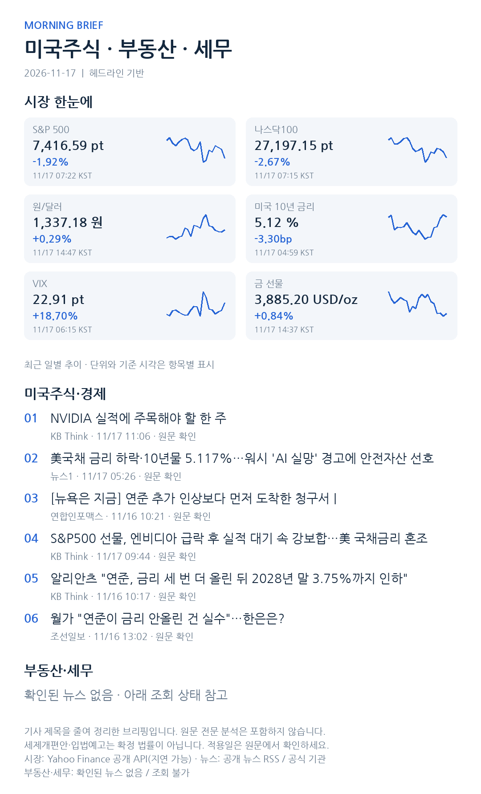

# 2026-11-17 미국주식·세무 브리핑

공개 뉴스 제목 기반입니다. 개별 세무 판단·매매 추천이 아닙니다.

1. [NVIDIA 실적에 주목해야 할 한 주](https://news.google.com/rss/articles/CBMiZkFVX3lxTE16dFFURUVCclBjd3g1TUFuS1c2WnpnaWNpemdxWW9jOW9ma2tGM0hGaVdPbGo3dzhGVTRHVWktbWNnbVVITzNUNzZaclVWMkFfYnhNVEh1OVlGYjByOFpZOVUxcWpZQQ?oc=5) — KB Think / 11/17 11:06 KST
2. [美국채 금리 하락·10년물 5.117%…워시 'AI 실망' 경고에 안전자산 선호](https://news.google.com/rss/articles/CBMiWEFVX3lxTE5hLU8tQml1WUhPZU5EWHpYUW13NElHcHBDRFlFVWdsWUJkQlV2aVFJSC1UODhXeXB1QzVhQ3RDT1ducFFJNy1JbXA1SWhGaFlOZW53SXhzdnY?oc=5) — 뉴스1 / 11/17 05:26 KST
3. [［뉴욕은 지금］ 연준 추가 인상보다 먼저 도착한 청구서 |](https://news.google.com/rss/articles/CBMidEFVX3lxTFBQMUxfR05MZ3pXM0IwTG93cmpiVHVfRC1wZEJtSThfUTdmd3ZScXJKSEt2ZVdMNDBFbFg2ZDZkaHp5Yk1odERGSk1kdEJhMERLOWhwZTNPY2NsQUpfel9zemZnLTNRaWJBVnF2bUxudGhBLTc2?oc=5) — 연합인포맥스 / 11/16 10:21 KST
4. [S&P500 선물, 엔비디아 급락 후 실적 대기 속 강보합…美 국채금리 혼조](https://news.google.com/rss/articles/CBMickFVX3lxTE96LXhBTnhnVDNiZ2RLR09zakMtYWxubXNoZ0lGYnVQV1NseW10WmIzak45X01uaXlrSXgzc1kxVG4wbEpYZGNHVmRsWTBTRUZoenZlSExpWFZuelhOd0RUZE51T0hDQ1dQT0lZTFdqN2ctQQ?oc=5) — KB Think / 11/17 09:44 KST
5. [알리안츠 "연준, 금리 세 번 더 올린 뒤 2028년 말 3.75%까지 인하"](https://news.google.com/rss/articles/CBMickFVX3lxTE5TMHlwQmpwR0c2dExYT0w5RWlDV211aTdiN095SnRhOUxydzNLTGVZeF8ta195Qi1RREI3YXdYVzRPcVRfYnI0S0l5WWJwZmdwdlJGdU02cjJTc0ZLdXI2WjlwYmVpLWxwNk1adlFFV1VwZw?oc=5) — KB Think / 11/16 10:17 KST
6. [월가 "연준이 금리 안올린 건 실수"…한은은?](https://news.google.com/rss/articles/CBMijgFBVV95cUxQSE1fU1hWQnhpN2NvcFZuTUNPY1Z1bEhCdDNhSGt3WEtUUVRMYWRvWHdUS3VnMFhXOFBPSGVqekVIV2RzV1RzZ0x1dHljNVlIMVhPekxvNmFjX1FTWlF5ZUJIM1FpVWp6ZW1NOWNaUVM0bG1ybXJUemVRbWF4S3BpQlJIS0YxSFJQN0Z3aTZ3?oc=5) — 조선일보 / 11/16 13:02 KST

## 시장 데이터

- [S&P 500](https://finance.yahoo.com/quote/%5EGSPC): 7,416.59 pt, -1.92% / 11/17 07:22 KST / Yahoo Finance 공개 차트 API (지연 가능)
- [나스닥100](https://finance.yahoo.com/quote/%5ENDX): 27,197.15 pt, -2.67% / 11/17 07:15 KST / Yahoo Finance 공개 차트 API (지연 가능)
- [원/달러](https://finance.yahoo.com/quote/KRW%3DX): 1,337.18 원, +0.29% / 11/17 14:47 KST / Yahoo Finance 공개 차트 API (지연 가능)
- [미국 10년 금리](https://finance.yahoo.com/quote/%5ETNX): 5.12 %, -3.30bp / 11/17 04:59 KST / Yahoo Finance 공개 차트 API (지연 가능)
- [VIX](https://finance.yahoo.com/quote/%5EVIX): 22.91 pt, +18.70% / 11/17 06:15 KST / Yahoo Finance 공개 차트 API (지연 가능)
- [금 선물](https://finance.yahoo.com/quote/GC%3DF): 3,885.20 USD/oz, +0.84% / 11/17 14:37 KST / Yahoo Finance 공개 차트 API (지연 가능)

부동산·세무: 확인된 뉴스 없음 / 조회 불가