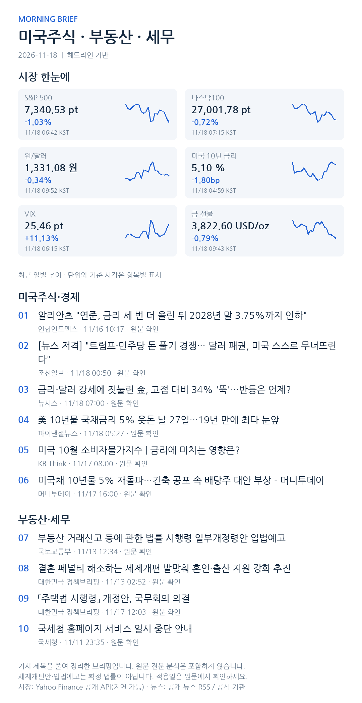

# 2026-11-18 미국주식·세무 브리핑

공개 뉴스 제목 기반입니다. 개별 세무 판단·매매 추천이 아닙니다.

1. [알리안츠 "연준, 금리 세 번 더 올린 뒤 2028년 말 3.75%까지 인하"](https://news.google.com/rss/articles/CBMicEFVX3lxTE1ybFdnRFU5TXVqNTNaX0MwRGpNaldTejRGOEZwcWgwcGZwSEYxLV9RQ3c2N1RnaU8tRF9hNkJEb3BsUGJfakMzSFdvdlFkeXhGamtRblltQ3hwQjB4VkxBeGFoNklfcjdqckZHOUxMRWE?oc=5) — 연합인포맥스 / 11/16 10:17 KST
2. [［뉴스 저격］ "트럼프·민주당 돈 풀기 경쟁… 달러 패권, 미국 스스로 무너뜨린다"](https://news.google.com/rss/articles/CBMijgFBVV95cUxQNGVRRzRFVGk1VDdLVXE1aGR5R3pIY1JleE5XYXlwV3VHOVMwREZGSE1HMW5lWHpNRVpwenhCMkFMUEtXNjB2SlNmUDF1NWlWRTN5VzB4NEJIcy1JY29JSWRXSUhPVS1YOUZDbmtSTmhjLURFQjB3a3JFV0JLRVpwbS0yaUlDNGhVQlF1U05n?oc=5) — 조선일보 / 11/18 00:50 KST
3. [금리·달러 강세에 짓눌린 金, 고점 대비 34% '뚝'…반등은 언제?](https://news.google.com/rss/articles/CBMiYEFVX3lxTE8yOExyZVhrMGUzLVBES3poMVlzajA2R3pxZnpmU1ROck9wV0R2MXlNYnAxX1JoNmFDXzF3VjhDd1BnMkFjUDBIemlTWGxlLWNyZHdrZ3ZPX0dXZ3hnR1RMZ9IBeEFVX3lxTE15dmVQaXdDM0xuZWhqaFgtMV9VVUNmenJHcHNqLVJ0MVdIZW5Gc2FXVWdnMk1HYm4ySjB2T0JGUDhGNnBSb2FYU3pKWEo4NGRrd1BCOGxkSzBHMXdrNHhFcVR4X0tDWmViMVZQM3BoVENpbk5ra2Z5Ug?oc=5) — 뉴시스 / 11/18 07:00 KST
4. [美 10년물 국채금리 5% 웃돈 날 27일…19년 만에 최다 눈앞](https://news.google.com/rss/articles/CBMiWkFVX3lxTE9JNW5fMnZ3MGZPellTVW44WnBaSURGVFQxZEcxMWg4WmdvRXo5ZDQwOW5ub3pDMm01UTY3bVNpWFh0Y1IzMXBmUnhPaGF5LUhtNk9ySzVpNGtiZw?oc=5) — 파이낸셜뉴스 / 11/18 05:27 KST
5. [미국 10월 소비자물가지수 | 금리에 미치는 영향은?](https://news.google.com/rss/articles/CBMib0FVX3lxTE9HT28xU0kxaXBzQ3ZwdkVYVEtrLUJQS3BJeXY0YmMwSzFOekhqMWNqd1VCUFlreFFJTG9zTDQteEEyd2J2cWJMcG1TZURMS0Q5aEFWVTJ1SC1YeFdwUGRYN0R6WkZnSmRYRWttMDdUaw?oc=5) — KB Think / 11/17 08:00 KST
6. [미국채 10년물 5% 재돌파…긴축 공포 속 배당주 대안 부상 - 머니투데이](https://news.google.com/rss/articles/CBMibkFVX3lxTFB5Q1dKWGZTT3RxZC1TM2R5TGdHWFVrZGVnWEFmVDdCa2NPWHRHc2pxUXhiSGFiSHJ6REdrNVR3a3hGU09qcjAwNzk3S3VrRGd6Q0tqZHg0ZHFVckliYXVzSGdFaUc0dG5tZTB1SWRR0gFuQVVfeXFMUHlDV0pYZlNPdHFkLVMzZHlMZ0dYVWtkZWdYQWZUN0JrY09YdEdzanFReGJIYWJIcnpER2s1VHdreEZTT2pyMDA3OTdLdWtEZ3pDS2pkeDRkcVVySWJhdXNIZ0VpRzR0bm1lMHVJZFE?oc=5) — 머니투데이 / 11/17 16:00 KST
7. [부동산 거래신고 등에 관한 법률 시행령 일부개정령안 입법예고](https://news.google.com/rss/articles/CBMiZkFVX3lxTE5uYm9SdXljdnBhT21TZi1acEhWVmN6U0t5YlZYVl9RM3FPX2tidzlmMkJfR2w0LVB6X0VOaDJXdWJoQU9fWVZydE4tNF9fTl8xT3dFaE1hRUp2bUVqV3JNZUpYUWxCUQ?oc=5) — 국토교통부 / 11/13 12:34 KST
8. [결혼 페널티 해소하는 세제개편 발맞춰 혼인·출산 지원 강화 추진](https://news.google.com/rss/articles/CBMirwFBVV95cUxORFhISVMzc0JuZVd0UG9wTFdQcW1QNkVtV1VVczd6RzVmQkowd24xTllZVWRBZ1Z3MVBWcmlwSVJsSWZ5aTM5cGNueHN0cS01WmhXdlVuM1dqaFctNElfcnBwNjJacG1kTkNtZ291bDVUR0c4S251Sm1lV3hzOG5YOG93NWxUMjAxejhWNHVBeWF2ci10WnlpUklnSjJIajBGSktnMDBMS0VQdXNRdW80?oc=5) — 대한민국 정책브리핑 / 11/13 02:52 KST
9. [「주택법 시행령」 개정안, 국무회의 의결](https://news.google.com/rss/articles/CBMilAFBVV95cUxQNmc2MGlmQzIyNHRjd0tySFRxaWl3MVplaDhCOUJYQnZxdW1rTURWZnlRV2lBMU5UdThGRDlPaE02LTNJaEVoaURVTkVrQTdPa3AtZnBnNHV6cU9sZW04bzFDYzlYQ01pOWlMUm1DQksyRWtidW9aZEhuUDBPM1FfUkMyWHF4Q2dZdHV4Q3BacDNHTWNC?oc=5) — 대한민국 정책브리핑 / 11/17 12:03 KST
10. [국세청 홈페이지 서비스 일시 중단 안내](https://news.google.com/rss/articles/CBMiigFBVV95cUxOZU02bFdZYklDcm4xUi1CclltWHlVZk9RVlNYZS14Z2kzelVEclFVSEhaOW0xRlREN2tyMVhVQWhxSGR6RmhCRlVuUzVFWExBOGk0bUd5d0NwVkFKODczcWJvdlEtOWVLM3VYTE1JbWp5Vlk5WFQ1SnhOSnQxV1FtQldwaXN1TmMwZHc?oc=5) — 국세청 / 11/11 23:35 KST

## 시장 데이터

- [S&P 500](https://finance.yahoo.com/quote/%5EGSPC): 7,340.53 pt, -1.03% / 11/18 06:42 KST / Yahoo Finance 공개 차트 API (지연 가능)
- [나스닥100](https://finance.yahoo.com/quote/%5ENDX): 27,001.78 pt, -0.72% / 11/18 07:15 KST / Yahoo Finance 공개 차트 API (지연 가능)
- [원/달러](https://finance.yahoo.com/quote/KRW%3DX): 1,331.08 원, -0.34% / 11/18 09:52 KST / Yahoo Finance 공개 차트 API (지연 가능)
- [미국 10년 금리](https://finance.yahoo.com/quote/%5ETNX): 5.10 %, -1.80bp / 11/18 04:59 KST / Yahoo Finance 공개 차트 API (지연 가능)
- [VIX](https://finance.yahoo.com/quote/%5EVIX): 25.46 pt, +11.13% / 11/18 06:15 KST / Yahoo Finance 공개 차트 API (지연 가능)
- [금 선물](https://finance.yahoo.com/quote/GC%3DF): 3,822.60 USD/oz, -0.79% / 11/18 09:43 KST / Yahoo Finance 공개 차트 API (지연 가능)
