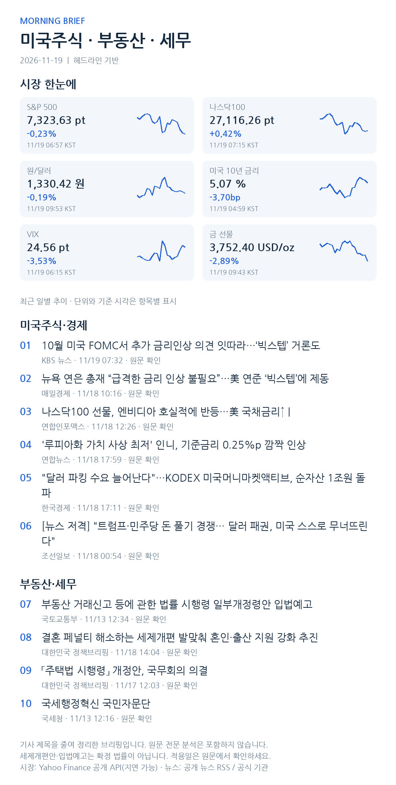

# 2026-11-19 미국주식·세무 브리핑

공개 뉴스 제목 기반입니다. 개별 세무 판단·매매 추천이 아닙니다.

1. [10월 미국 FOMC서 추가 금리인상 의견 잇따라…‘빅스텝’ 거론도](https://news.google.com/rss/articles/CBMiW0FVX3lxTE1HN1R5UTFiZWR6ZVZtZEt2dmVycnRvOGtjR2g0ZmNMdFJaUlpKVUltVUhRTFRJN21VQlJ4OHdfVUg0b0FySTZoZkRqWVRnQklkT05WNDJySjB6MEE?oc=5) — KBS 뉴스 / 11/19 07:32 KST
2. [뉴욕 연은 총재 “급격한 금리 인상 불필요”…美 연준 ‘빅스텝’에 제동](https://news.google.com/rss/articles/CBMiUkFVX3lxTE15dnhWOVBVcU8xcjZtOEpTbk91MWx6VWdEeUxoNGpVMEp2T3NyVmZucXZweDJzQWpuRFpRU2lHLVFUOGU4M1MwcnJxX0VLMWZMN1E?oc=5) — 매일경제 / 11/18 10:16 KST
3. [나스닥100 선물, 엔비디아 호실적에 반등…美 국채금리↑ |](https://news.google.com/rss/articles/CBMidEFVX3lxTFBTcE5CNW1TelJ4YWxVZW5BR0kzTWs0Q25mM3ZBRVc5UmpGNVpDWlMySXptaEk1RDdGakt3cWNCWWM3dDROTHN4Z0xvZUNob3lseVZBZzduT0tFa3NlSHZXY3l1NkU2QlUweXBUOTJQc1puNnJM?oc=5) — 연합인포맥스 / 11/18 12:26 KST
4. ['루피아화 가치 사상 최저' 인니, 기준금리 0.25%p 깜짝 인상](https://news.google.com/rss/articles/CBMiYEFVX3lxTE5tc2Fvd2ljUDZwYU44VUNTYXpjb2JQTWJzUW5NTmtVQ1phOXNEQVhFWmh4LWN0QmxBZDM0cDBnN2E2RWlVdDhSZ1VqQ3FZZmR2S3ZRRTBEM01mYkxBUU1FWtIBYEFVX3lxTE5tc2Fvd2ljUDZwYU44VUNTYXpjb2JQTWJzUW5NTmtVQ1phOXNEQVhFWmh4LWN0QmxBZDM0cDBnN2E2RWlVdDhSZ1VqQ3FZZmR2S3ZRRTBEM01mYkxBUU1FWg?oc=5) — 연합뉴스 / 11/18 17:59 KST
5. ["달러 파킹 수요 늘어난다"…KODEX 미국머니마켓액티브, 순자산 1조원 돌파](https://news.google.com/rss/articles/CBMiWkFVX3lxTE5xZ3Y2ZnItN3MyOWN3TTRveEpXSFZFZlNiYlQtaENsZmVQb3JFRjQ2NndqTHJabG93V19lX2w4TkpuNFZzSElRUE1pZmZKVmVvZWY5aGdMeWJRUQ?oc=5) — 한국경제 / 11/18 17:11 KST
6. [［뉴스 저격］ "트럼프·민주당 돈 풀기 경쟁… 달러 패권, 미국 스스로 무너뜨린다"](https://news.google.com/rss/articles/CBMijgFBVV95cUxQNGVRRzRFVGk1VDdLVXE1aGR5R3pIY1JleE5XYXlwV3VHOVMwREZGSE1HMW5lWHpNRVpwenhCMkFMUEtXNjB2SlNmUDF1NWlWRTN5VzB4NEJIcy1JY29JSWRXSUhPVS1YOUZDbmtSTmhjLURFQjB3a3JFV0JLRVpwbS0yaUlDNGhVQlF1U05n?oc=5) — 조선일보 / 11/18 00:54 KST
7. [부동산 거래신고 등에 관한 법률 시행령 일부개정령안 입법예고](https://news.google.com/rss/articles/CBMiZkFVX3lxTE5uYm9SdXljdnBhT21TZi1acEhWVmN6U0t5YlZYVl9RM3FPX2tidzlmMkJfR2w0LVB6X0VOaDJXdWJoQU9fWVZydE4tNF9fTl8xT3dFaE1hRUp2bUVqV3JNZUpYUWxCUQ?oc=5) — 국토교통부 / 11/13 12:34 KST
8. [결혼 페널티 해소하는 세제개편 발맞춰 혼인·출산 지원 강화 추진](https://news.google.com/rss/articles/CBMirwFBVV95cUxORFhISVMzc0JuZVd0UG9wTFdQcW1QNkVtV1VVczd6RzVmQkowd24xTllZVWRBZ1Z3MVBWcmlwSVJsSWZ5aTM5cGNueHN0cS01WmhXdlVuM1dqaFctNElfcnBwNjJacG1kTkNtZ291bDVUR0c4S251Sm1lV3hzOG5YOG93NWxUMjAxejhWNHVBeWF2ci10WnlpUklnSjJIajBGSktnMDBMS0VQdXNRdW80?oc=5) — 대한민국 정책브리핑 / 11/18 14:04 KST
9. [「주택법 시행령」 개정안, 국무회의 의결](https://news.google.com/rss/articles/CBMilAFBVV95cUxQNmc2MGlmQzIyNHRjd0tySFRxaWl3MVplaDhCOUJYQnZxdW1rTURWZnlRV2lBMU5UdThGRDlPaE02LTNJaEVoaURVTkVrQTdPa3AtZnBnNHV6cU9sZW04bzFDYzlYQ01pOWlMUm1DQksyRWtidW9aZEhuUDBPM1FfUkMyWHF4Q2dZdHV4Q3BacDNHTWNC?oc=5) — 대한민국 정책브리핑 / 11/17 12:03 KST
10. [국세행정혁신 국민자문단](https://news.google.com/rss/articles/CBMie0FVX3lxTE1aUTdXMlg5OEVQWHpRR1lreTROZ0F3VFRRaV84YmJPdWRrQ2dWZC1DT3VlUHNPZEFlamFxUXJXWXUxR2hWRlM2M3g5YzJQcjM5eGJWLXgySFk0V0ZHTUp6WEJfOUpJcktDOXlCZVVpU180N1VBWV9uMUs5Zw?oc=5) — 국세청 / 11/13 12:16 KST

## 시장 데이터

- [S&P 500](https://finance.yahoo.com/quote/%5EGSPC): 7,323.63 pt, -0.23% / 11/19 06:57 KST / Yahoo Finance 공개 차트 API (지연 가능)
- [나스닥100](https://finance.yahoo.com/quote/%5ENDX): 27,116.26 pt, +0.42% / 11/19 07:15 KST / Yahoo Finance 공개 차트 API (지연 가능)
- [원/달러](https://finance.yahoo.com/quote/KRW%3DX): 1,330.42 원, -0.19% / 11/19 09:53 KST / Yahoo Finance 공개 차트 API (지연 가능)
- [미국 10년 금리](https://finance.yahoo.com/quote/%5ETNX): 5.07 %, -3.70bp / 11/19 04:59 KST / Yahoo Finance 공개 차트 API (지연 가능)
- [VIX](https://finance.yahoo.com/quote/%5EVIX): 24.56 pt, -3.53% / 11/19 06:15 KST / Yahoo Finance 공개 차트 API (지연 가능)
- [금 선물](https://finance.yahoo.com/quote/GC%3DF): 3,752.40 USD/oz, -2.89% / 11/19 09:43 KST / Yahoo Finance 공개 차트 API (지연 가능)
