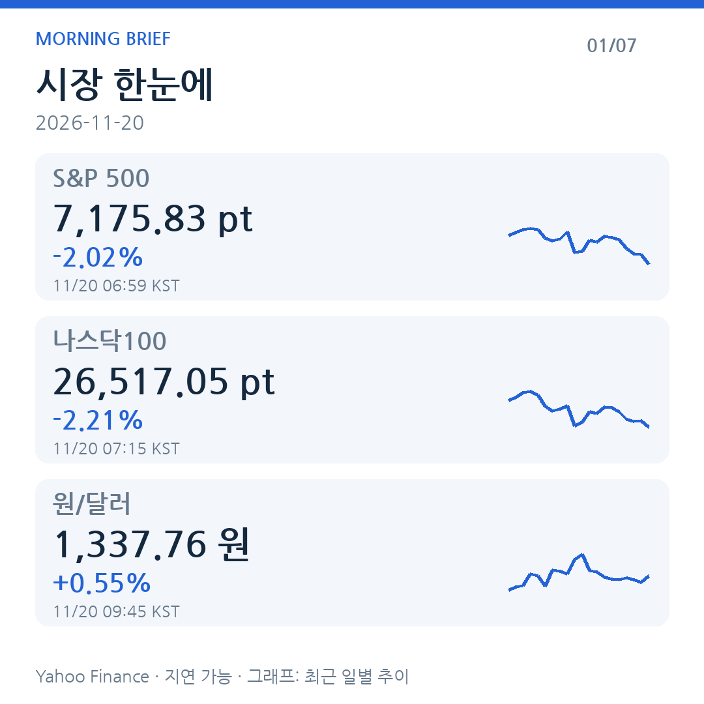
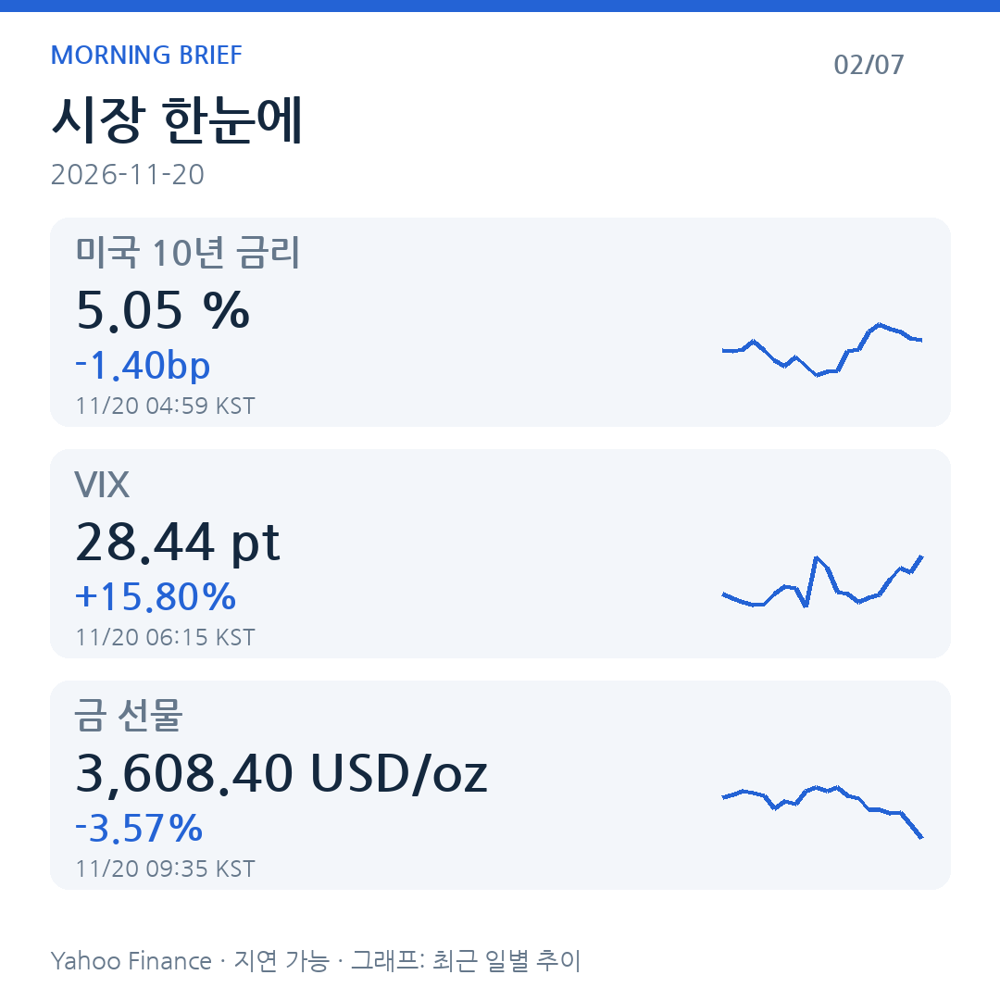
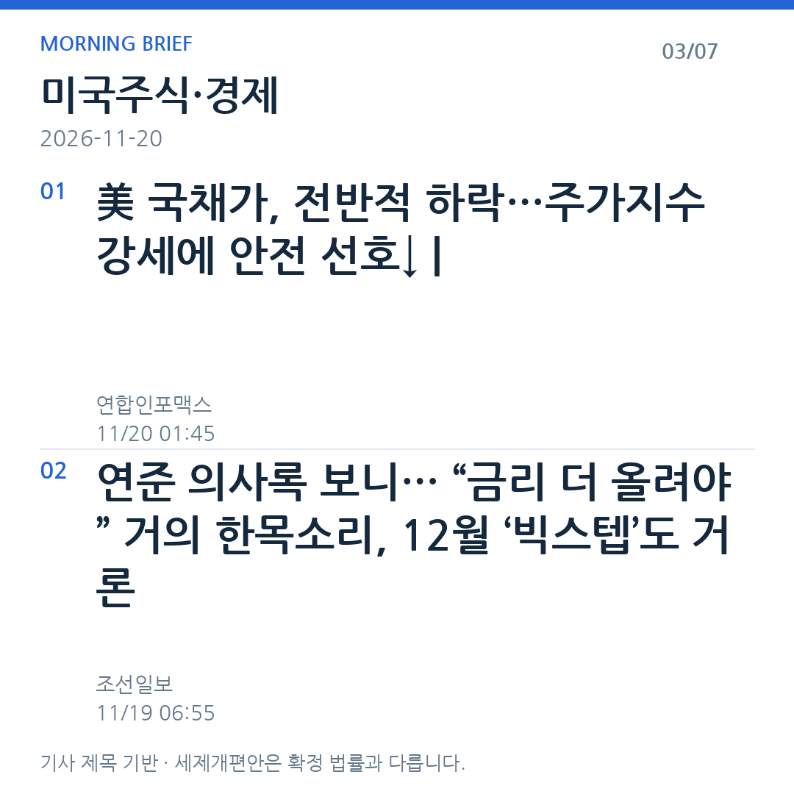
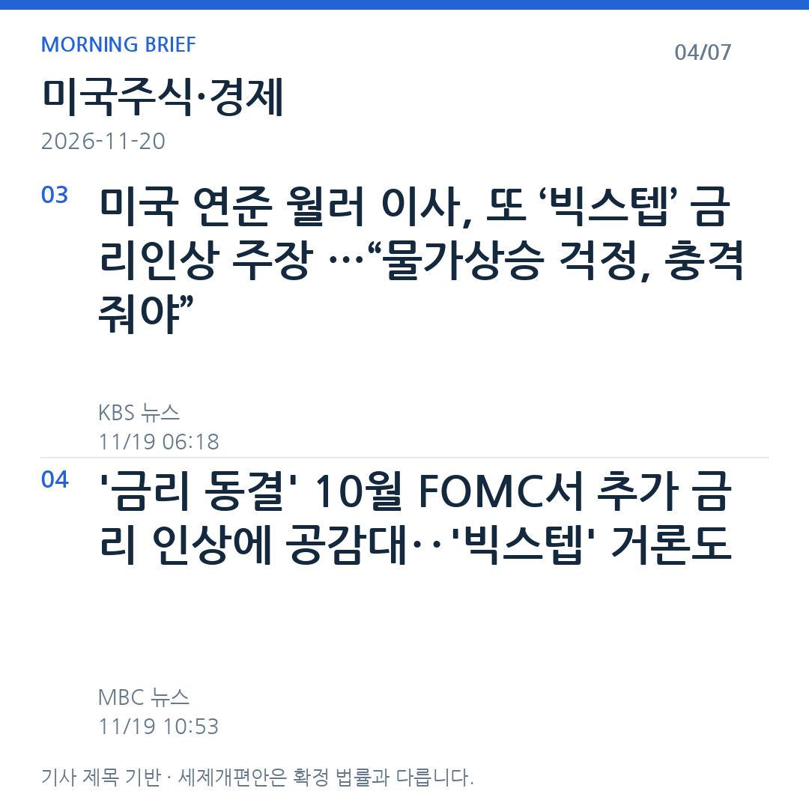
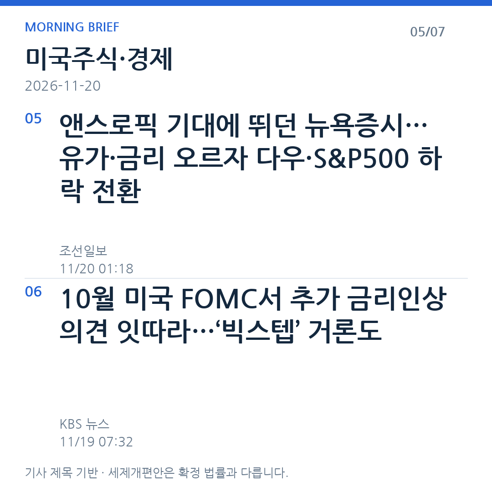
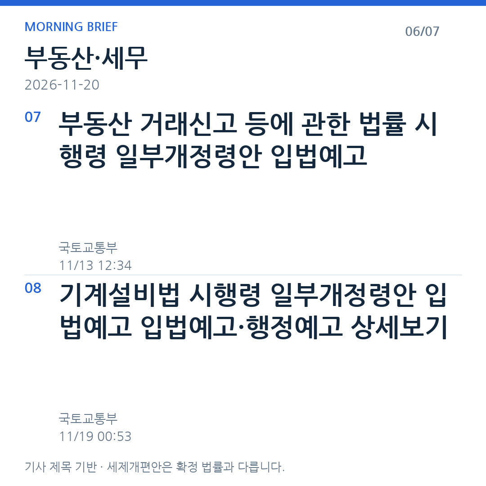
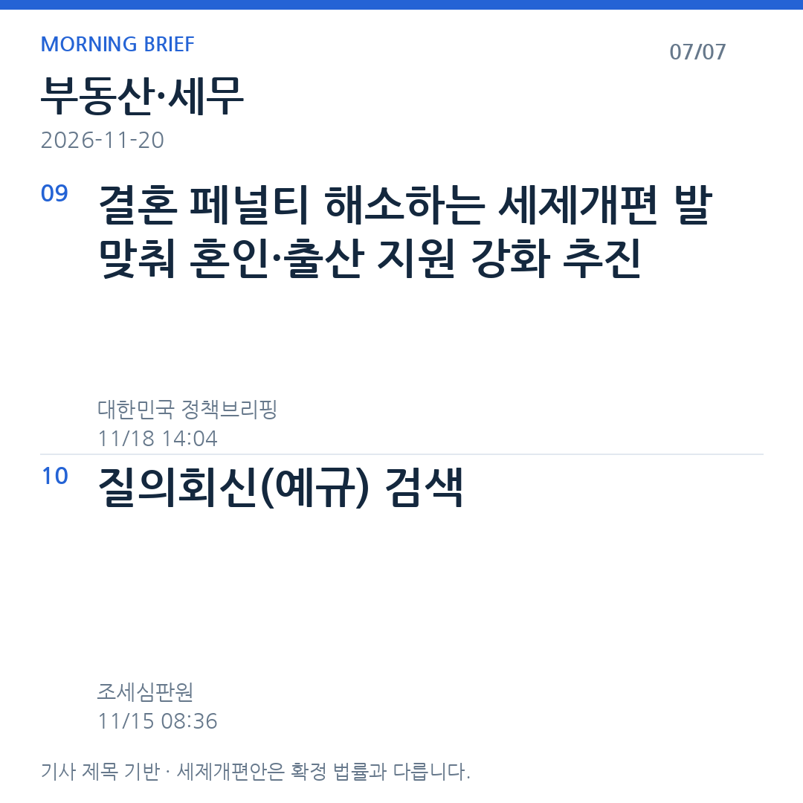

# 2026-11-20 미국주식·세무 브리핑

공개 뉴스 제목 기반입니다. 개별 세무 판단·매매 추천이 아닙니다.

1. [美 국채가, 전반적 하락…주가지수 강세에 안전 선호↓ |](https://news.google.com/rss/articles/CBMidEFVX3lxTE9ibzF5N1RKSVd5Q3laeUdSR1gweTFYLXQzMzBGUDdWaHhGNVR4MVJTSUVzWUNWMlllWm9HOThjN0lJT0NvelVrSnZmb3dXQ1Zpdkc4YnFTa1F5NEFwZGRxY2Q4RlItVkhVakFkVE9xZ2E3Zm9r?oc=5) — 연합인포맥스 / 11/20 01:45 KST
2. [연준 의사록 보니… “금리 더 올려야” 거의 한목소리, 12월 ‘빅스텝’도 거론](https://news.google.com/rss/articles/CBMiiAFBVV95cUxPM3ZveEtXbE1jSTdUcFM4UDZaSzNrVDNDcHUxdnhQVW5lTWZfcTQxYW5sa1JaVGgzLVdQTEl2Qi0wd3lScWo5MjdJRGJJNXU0NjBfUUJ0blBlX1h4TkZhdV96anBlVmZsVXc2Y1lYcmlxTHhsemdzRHdDRXhoOXpqTTBDVzd0VUto?oc=5) — 조선일보 / 11/19 06:55 KST
3. [미국 연준 월러 이사, 또 ‘빅스텝’ 금리인상 주장 …“물가상승 걱정, 충격줘야”](https://news.google.com/rss/articles/CBMiZkFVX3lxTE1QQjNISmRNX0RPUXhIQTk4bk5fUVNicWlNeldtaEt3dGlDazJQRWI1ZFJMc3dUeUhBT0FNem5BY1dtTEZnTm1Ia1RoVUxDeGN5YkdjUGxkbUxLQUMyWERtOXFOZnZlZw?oc=5) — KBS 뉴스 / 11/19 06:18 KST
4. ['금리 동결' 10월 FOMC서 추가 금리 인상에 공감대‥'빅스텝' 거론도](https://news.google.com/rss/articles/CBMidEFVX3lxTE5vbzdrRWMtdWxNMzFNd1UzVnF3bDEwWDI1S3EtQU00ZDJrdFd3dHlpRlN6RHdhRmlqZk0wRDJYVG5lR042N1VYSVF4RTFyckJTWDBJSVhtWUt3MWQwZ3pHWjBHX3o1VVNNOEJiTU13alh1N3pa0gF0QVVfeXFMTWVTSTkxVmxYWG8wc2RqYzI4YjEtMGR3VWR6QTB4UnRuMFhhbDdJQUs4T3VpQXFwLUYxbnlWMVdoUHFQMDhxdmZjYW5oTGs2QTk5Vlk1MjZNMlBVWlF2LWhGWHZxMEpHTlNLbGoxRWh0LWVRa0Q?oc=5) — MBC 뉴스 / 11/19 10:53 KST
5. [앤스로픽 기대에 뛰던 뉴욕증시… 유가·금리 오르자 다우·S&P500 하락 전환](https://news.google.com/rss/articles/CBMiiAFBVV95cUxOZkozS3U3U05LNGRJZTcza3JMSmtaWVdGT00zUGdlMzVHcUdZc2tzRlJPcVIzbFhtSDhRZWNLZGtjZTVUemlNSnJQRUYtU0l0T2Q4ZGFLbUdEb1N3RFVkc0FLR0wxblBRSWVHZzQ5eDd5cU9BQTdVMzhwVVMzMUNaMWFab1AzRXUw?oc=5) — 조선일보 / 11/20 01:18 KST
6. [10월 미국 FOMC서 추가 금리인상 의견 잇따라…‘빅스텝’ 거론도](https://news.google.com/rss/articles/CBMiW0FVX3lxTE1HN1R5UTFiZWR6ZVZtZEt2dmVycnRvOGtjR2g0ZmNMdFJaUlpKVUltVUhRTFRJN21VQlJ4OHdfVUg0b0FySTZoZkRqWVRnQklkT05WNDJySjB6MEE?oc=5) — KBS 뉴스 / 11/19 07:32 KST
7. [부동산 거래신고 등에 관한 법률 시행령 일부개정령안 입법예고](https://news.google.com/rss/articles/CBMiZkFVX3lxTE5uYm9SdXljdnBhT21TZi1acEhWVmN6U0t5YlZYVl9RM3FPX2tidzlmMkJfR2w0LVB6X0VOaDJXdWJoQU9fWVZydE4tNF9fTl8xT3dFaE1hRUp2bUVqV3JNZUpYUWxCUQ?oc=5) — 국토교통부 / 11/13 12:34 KST
8. [기계설비법 시행령 일부개정령안 입법예고 입법예고·행정예고 상세보기](https://news.google.com/rss/articles/CBMiZkFVX3lxTE9ldmQxUkZDSko0Nm9jaWw1RUxMMlh0VHFyUFVjeWNHdURzX1ZlenpXNkg4UEFjVzVkbzdhTjJuWjkzR21nbnlvQ0xaV0RiQmc5MEIwZGR4aFFpaC1JN1hKUGJHX2FYdw?oc=5) — 국토교통부 / 11/19 00:53 KST
9. [결혼 페널티 해소하는 세제개편 발맞춰 혼인·출산 지원 강화 추진](https://news.google.com/rss/articles/CBMirwFBVV95cUxORFhISVMzc0JuZVd0UG9wTFdQcW1QNkVtV1VVczd6RzVmQkowd24xTllZVWRBZ1Z3MVBWcmlwSVJsSWZ5aTM5cGNueHN0cS01WmhXdlVuM1dqaFctNElfcnBwNjJacG1kTkNtZ291bDVUR0c4S251Sm1lV3hzOG5YOG93NWxUMjAxejhWNHVBeWF2ci10WnlpUklnSjJIajBGSktnMDBMS0VQdXNRdW80?oc=5) — 대한민국 정책브리핑 / 11/18 14:04 KST
10. [질의회신(예규) 검색](https://news.google.com/rss/articles/CBMiY0FVX3lxTE0xd0VvZjRoNUxHZzFPb3BBMjFMU3BhaTJ3ZmZmTGxPRDMyb2NuXzA1bTJYTGpubktTVnNaVXp5eDNTN1k4UlR4cklJcjdTWDZCNGtFaTdmemRBWnRvbmp6Vnphdw?oc=5) — 조세심판원 / 11/15 08:36 KST

## 시장 데이터

- [S&P 500](https://finance.yahoo.com/quote/%5EGSPC): 7,175.83 pt, -2.02% / 11/20 06:59 KST / Yahoo Finance 공개 차트 API (지연 가능)
- [나스닥100](https://finance.yahoo.com/quote/%5ENDX): 26,517.05 pt, -2.21% / 11/20 07:15 KST / Yahoo Finance 공개 차트 API (지연 가능)
- [원/달러](https://finance.yahoo.com/quote/KRW%3DX): 1,337.76 원, +0.55% / 11/20 09:45 KST / Yahoo Finance 공개 차트 API (지연 가능)
- [미국 10년 금리](https://finance.yahoo.com/quote/%5ETNX): 5.05 %, -1.40bp / 11/20 04:59 KST / Yahoo Finance 공개 차트 API (지연 가능)
- [VIX](https://finance.yahoo.com/quote/%5EVIX): 28.44 pt, +15.80% / 11/20 06:15 KST / Yahoo Finance 공개 차트 API (지연 가능)
- [금 선물](https://finance.yahoo.com/quote/GC%3DF): 3,608.40 USD/oz, -3.57% / 11/20 09:35 KST / Yahoo Finance 공개 차트 API (지연 가능)
