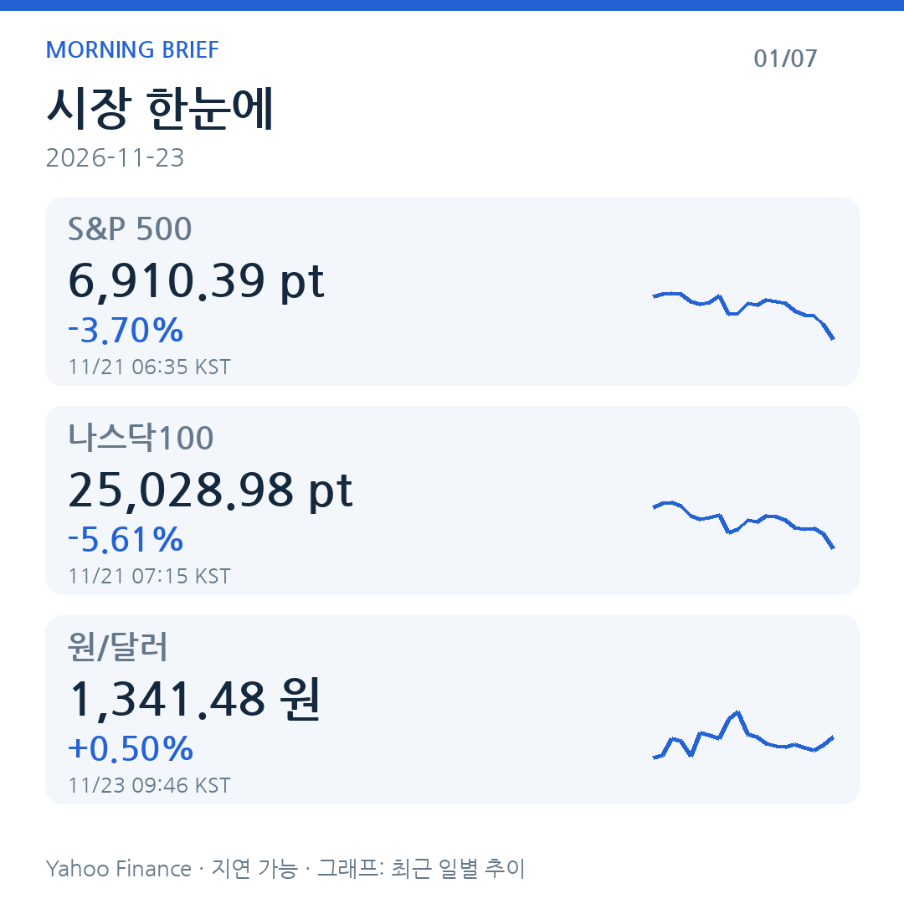
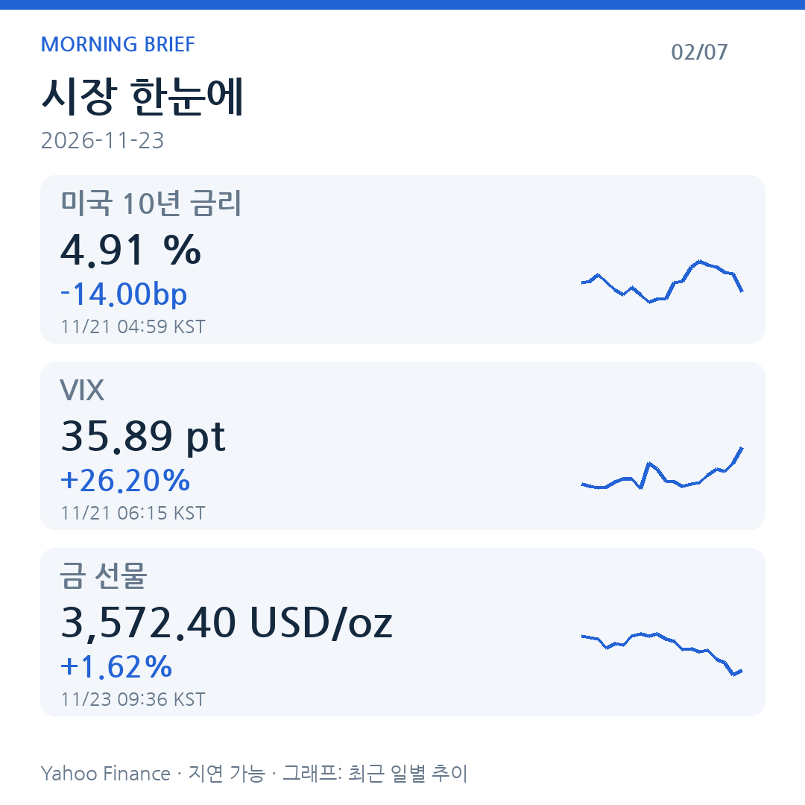
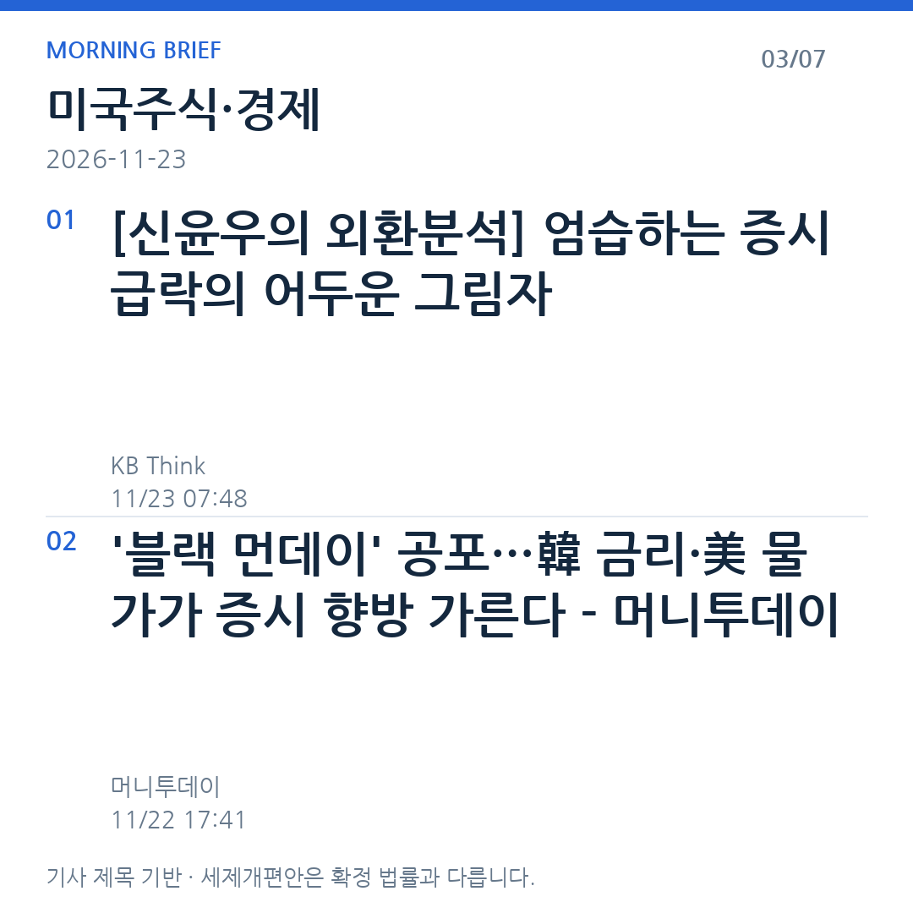
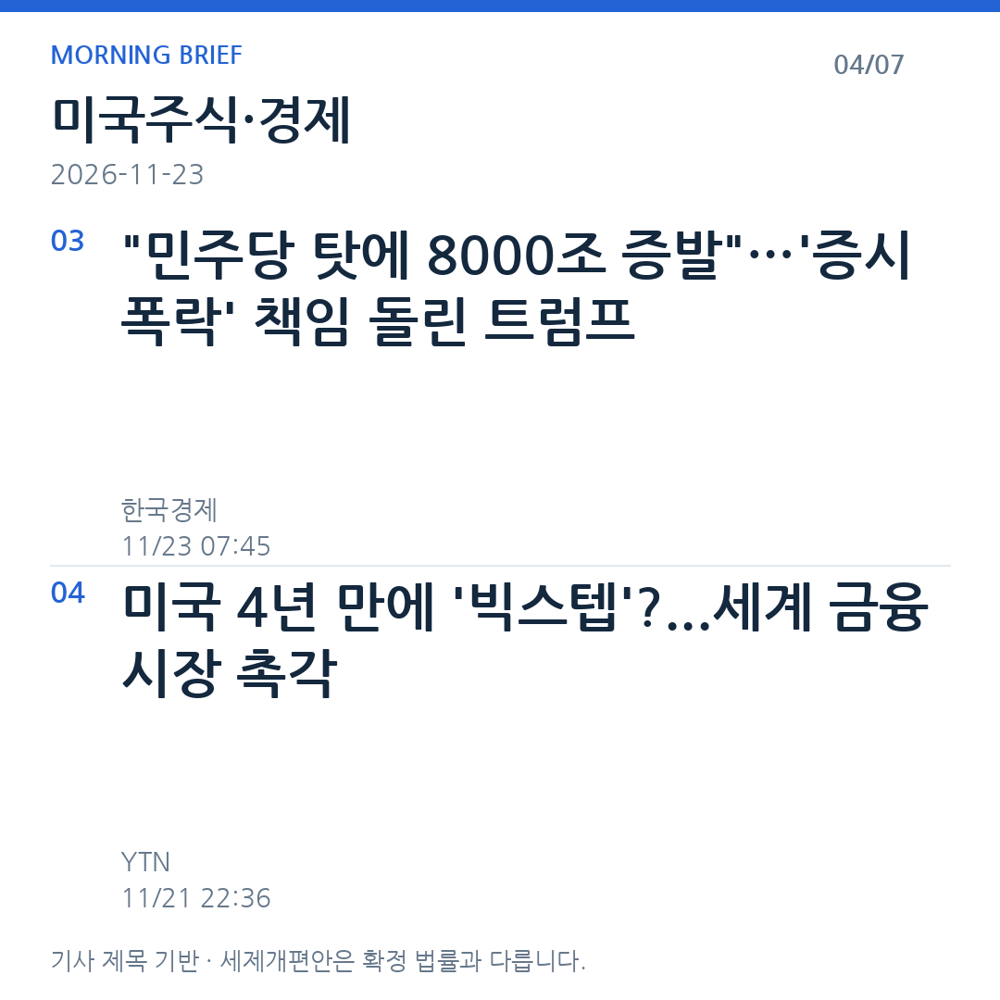
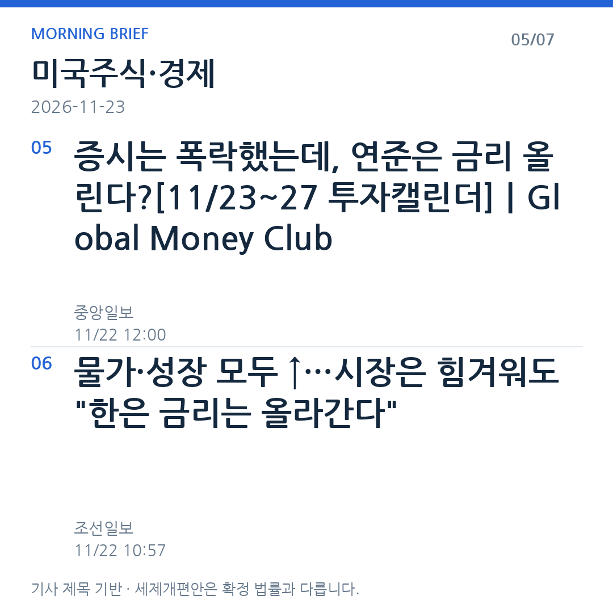
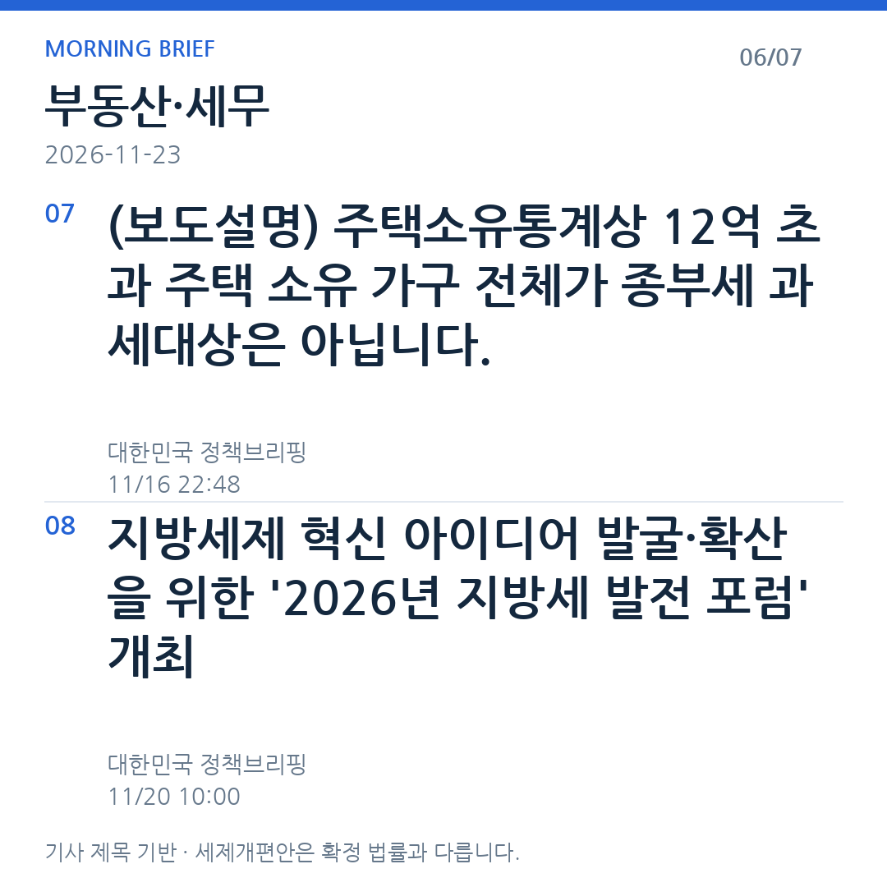
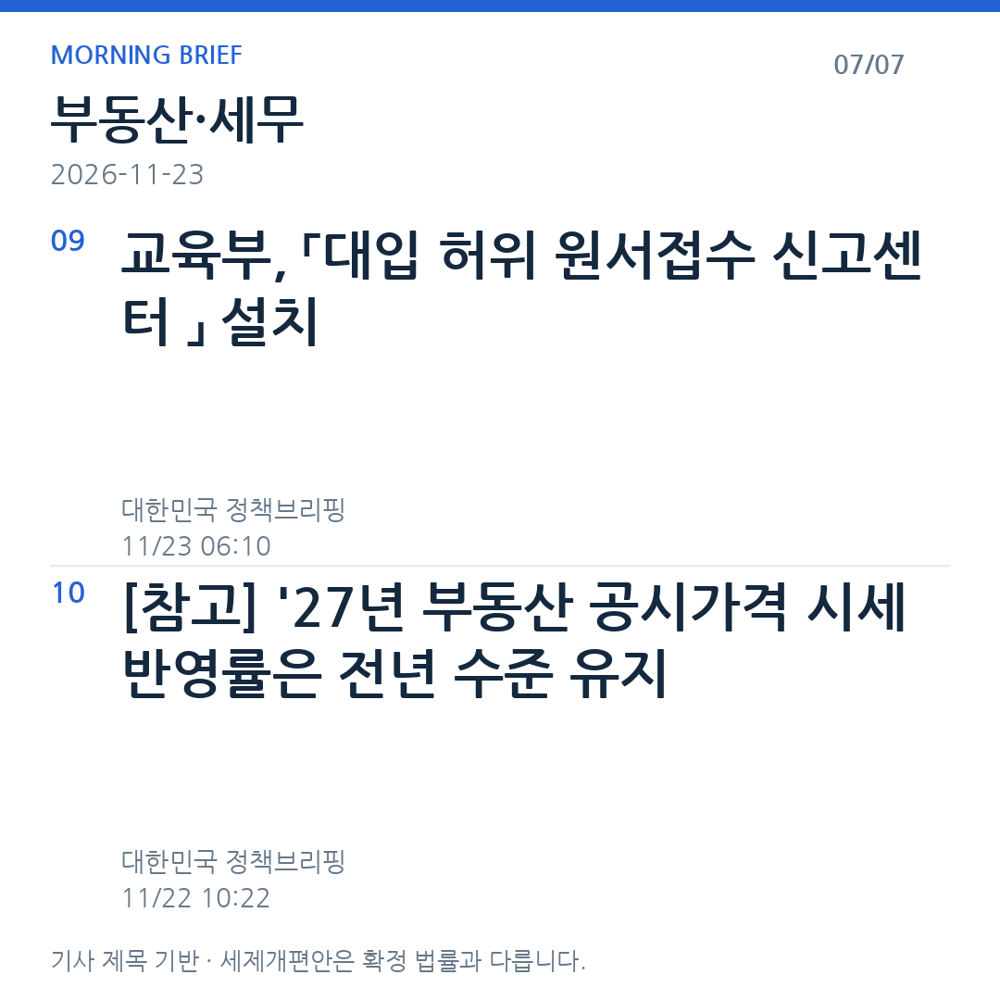

# 2026-11-23 미국주식·세무 브리핑

공개 뉴스 제목 기반입니다. 개별 세무 판단·매매 추천이 아닙니다.

1. [［신윤우의 외환분석］ 엄습하는 증시 급락의 어두운 그림자](https://news.google.com/rss/articles/CBMickFVX3lxTE1LbXVFeXFvbmFCOS05NEo2RmhmS1RzMVMteW9Lay1ZX084NnhudDJLT1ZVcE5mdVZWUHBWWGNLRTFBRlNBRVdEYWdrcU1ocEhYVGJlUkhKcWoxVmlnanVGTzdzWkFvTjIxdWNPSDNpODJIZw?oc=5) — KB Think / 11/23 07:48 KST
2. ['블랙 먼데이' 공포…韓 금리·美 물가가 증시 향방 가른다 - 머니투데이](https://news.google.com/rss/articles/CBMiaEFVX3lxTE5NeEFwOFZRdTJaNmVBdE11MUtKeWJaekw5TktWYTdIQVF3cDl4VlFzY2laWUFaUE1BcndIbmlaU1JSaklCVklmQ0FQUGYycm5YMDhidlJndDREY1h5MEhwSER0dFQ0MTd40gFuQVVfeXFMUHlual9LSEpuejYwNnNFMTAxTFVEcTFma2JvZjVjRzl0SV9ndDN1ai1kX0d3ak05RTM5czZ2eVB4b2RhU2ptZ29jS2Z4bXAtbXFzZm9UclpIRDNJdzFsSnoyNm5iZnNSZnk1MjA2dnc?oc=5) — 머니투데이 / 11/22 17:41 KST
3. ["민주당 탓에 8000조 증발"…'증시 폭락' 책임 돌린 트럼프](https://news.google.com/rss/articles/CBMiWkFVX3lxTE5IMW12ZlBqb0FVMFVlaVE2MnZKTGZDLWlrQ3Z5dk9OX3lNMGVPdEZOdU42N3F1MzkxTUhFVGVxVmRnMGtDN2k2ZldKZ2JMNWliUGMzSks2M3BwUQ?oc=5) — 한국경제 / 11/23 07:45 KST
4. [미국 4년 만에 '빅스텝'?...세계 금융시장 촉각](https://news.google.com/rss/articles/CBMidkFVX3lxTE9teVBYekhYc3NMeW56YVNrUlgzM3FhbnBXYVZiSDZMbHEtMGYxTGF5dHVtTk1EdnNzTHZkV3dOXzQ0SGtrbFpsMU04TDJOTzlkZVFRdkdGUUYyYXBPb1ktODBuZk9pUDlNd3BVMnJEYW5QRU5xa0E?oc=5) — YTN / 11/21 22:36 KST
5. [증시는 폭락했는데, 연준은 금리 올린다?［11/23~27 투자캘린더］｜Global Money Club](https://news.google.com/rss/articles/CBMiW0FVX3lxTE9Yem1nQU4tOTdtLTk2dGxSdjRSSnMtcWdqSmdiZnhubFBtaGxuMkhWVjU5SkYzTWxweTl5QWhKUWYzV2tYOVhSemNIb0FaQ1AwRGdZY2o2YzVqbTg?oc=5) — 중앙일보 / 11/22 12:00 KST
6. [물가·성장 모두 ↑…시장은 힘겨워도 "한은 금리는 올라간다"](https://news.google.com/rss/articles/CBMijgFBVV95cUxOTWZGaHVHRTRqSnNobWNmeXYwS2p0YUMxaVladDh4eXFLNFBMRURKcU1xeWxMODZrdnhxeHlzVGJIa1BrVkdNTUNkYkU2cTlWMXBVb3dTN3BQVURrbFRBTGZsd1dhQ3ppVUhvYnBJQnA1Szc4M2djOUZaaUJPRVF0c0Z5RWdHZmZheWRyQ0tn?oc=5) — 조선일보 / 11/22 10:57 KST
7. [(보도설명) 주택소유통계상 12억 초과 주택 소유 가구 전체가 종부세 과세대상은 아닙니다.](https://news.google.com/rss/articles/CBMiiAFBVV95cUxOTlpfekwtcmlpVEVGZFhkNURTTUJLME9wWGZyTk9oRWV6dWxkYkRrRGFJeFg4MTJIc0pTUWNBMzVuLUdWVHZXRjYwOHRjM2hoSFhQRXNhNkIxRnd5N0pYZ003NG03d0lLWVhGa2pVcjZLeGZNaHA2ZldmUVItaW1rRkgyU1FnTEZR?oc=5) — 대한민국 정책브리핑 / 11/16 22:48 KST
8. [지방세제 혁신 아이디어 발굴·확산을 위한 '2026년 지방세 발전 포럼' 개최](https://news.google.com/rss/articles/CBMidEFVX3lxTE44eVJkWk5vNlVRMjkzeGVZaGwzQ0Q2bGlhMWNFTjFBWDI3a0VwdXA4eThETHE3QVZMaWY1NkRWR3Y5YlhCNnRkd2RIcHBpT3RnUW5nejhZRjFySTdLalFuZER2b25MazR5Q1kxb0tnREwtT3BN?oc=5) — 대한민국 정책브리핑 / 11/20 10:00 KST
9. [교육부, 「대입 허위 원서접수 신고센터 」 설치](https://news.google.com/rss/articles/CBMikgFBVV95cUxNQ29lc0ZCODlNcEg1U1pqRDhCZ1l1NmlvSjJXNElzQkVqUXNWZFA3YW1VaFhCVUNqY3FrLUg1cm4zTUtRMi1rZkttWG9ZM1RueE1kb29hS0JEd05iT0hneThtMWRLWVFpY0pEZkUxRjB2WXRJWER2Zm5jRG95RzlIOE5ycHk5cnpKZzJzZm1fQjBMZw?oc=5) — 대한민국 정책브리핑 / 11/23 06:10 KST
10. [［참고］ '27년 부동산 공시가격 시세반영률은 전년 수준 유지](https://news.google.com/rss/articles/CBMidEFVX3lxTE1LN2luWER6azZfNV9vSi14R2doN1hfTVBOeEFUcnV2VWd5TkhHX2ZObno5QW1PcTYzblVUVHg3U2dUc054OUtsWHlBVlpuazNzSWZQSVV5SXNvUUk5SGdxQzZSNGFOZDE1WGduY29jOG9PdnB4?oc=5) — 대한민국 정책브리핑 / 11/22 10:22 KST

## 시장 데이터

- [S&P 500](https://finance.yahoo.com/quote/%5EGSPC): 6,910.39 pt, -3.70% / 11/21 06:35 KST / Yahoo Finance 공개 차트 API (지연 가능)
- [나스닥100](https://finance.yahoo.com/quote/%5ENDX): 25,028.98 pt, -5.61% / 11/21 07:15 KST / Yahoo Finance 공개 차트 API (지연 가능)
- [원/달러](https://finance.yahoo.com/quote/KRW%3DX): 1,341.48 원, +0.50% / 11/23 09:46 KST / Yahoo Finance 공개 차트 API (지연 가능)
- [미국 10년 금리](https://finance.yahoo.com/quote/%5ETNX): 4.91 %, -14.00bp / 11/21 04:59 KST / Yahoo Finance 공개 차트 API (지연 가능)
- [VIX](https://finance.yahoo.com/quote/%5EVIX): 35.89 pt, +26.20% / 11/21 06:15 KST / Yahoo Finance 공개 차트 API (지연 가능)
- [금 선물](https://finance.yahoo.com/quote/GC%3DF): 3,572.40 USD/oz, +1.62% / 11/23 09:36 KST / Yahoo Finance 공개 차트 API (지연 가능)
