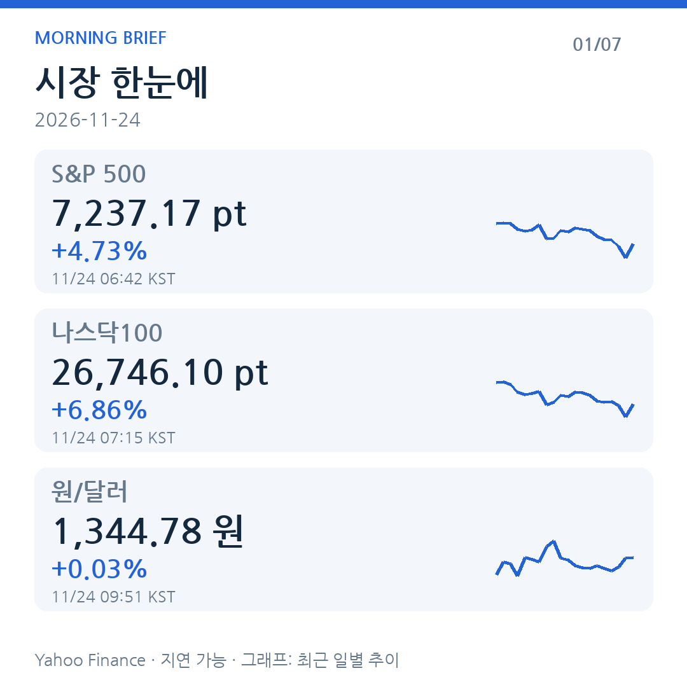
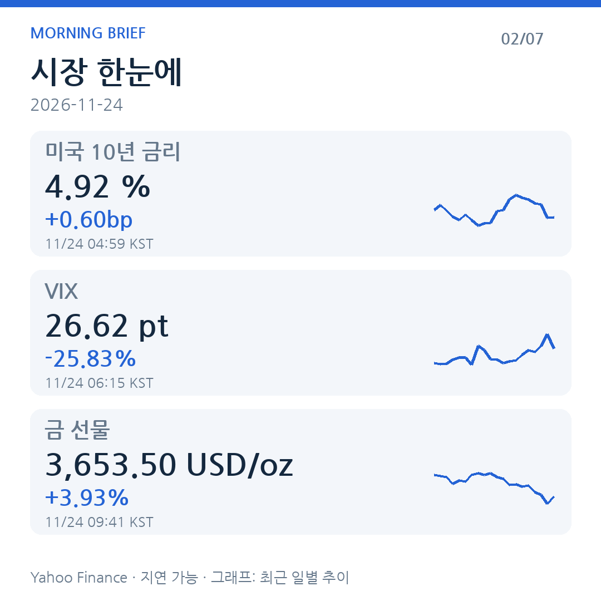
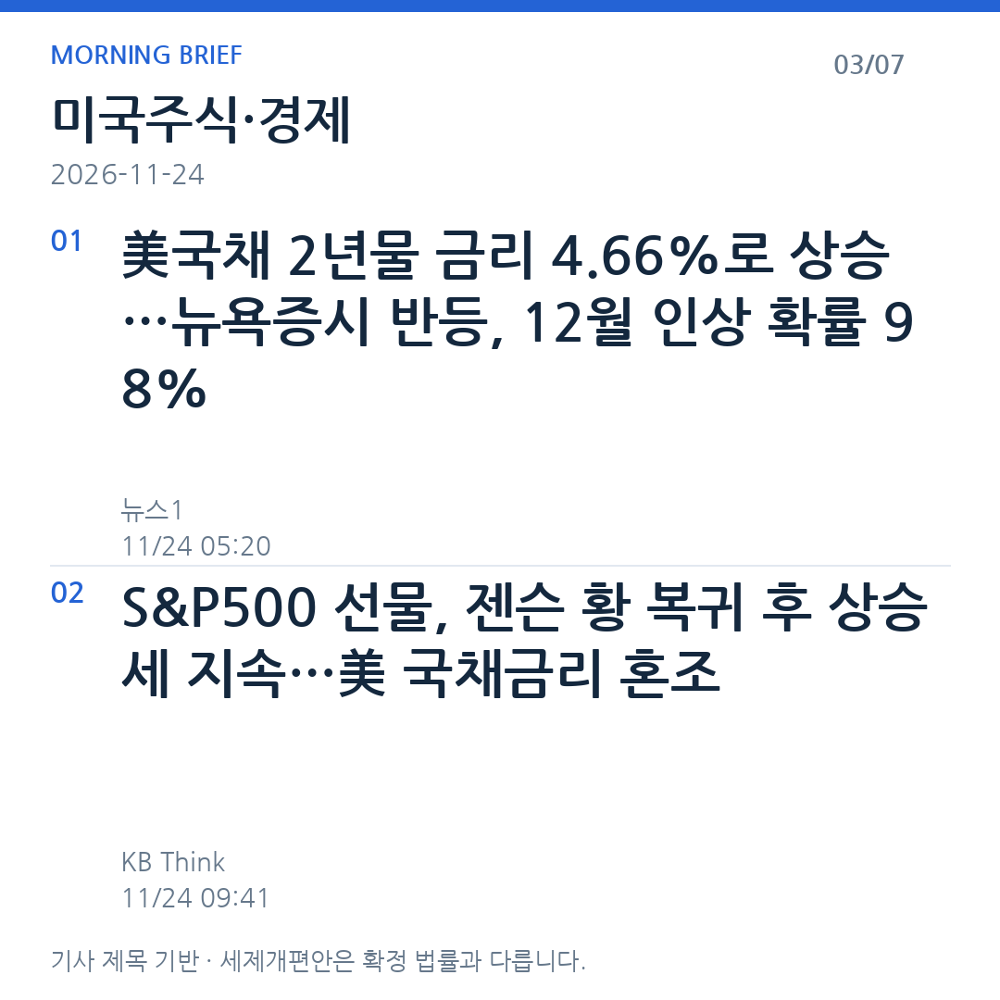
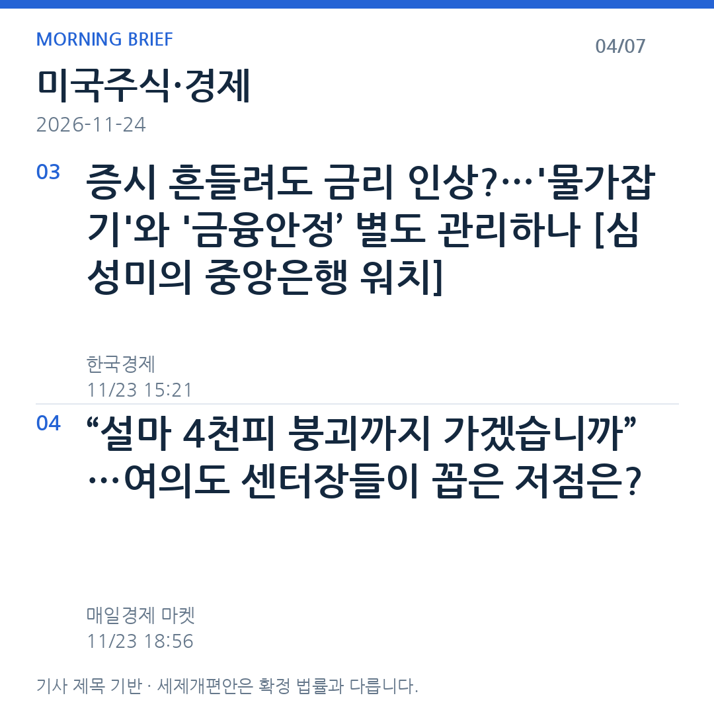
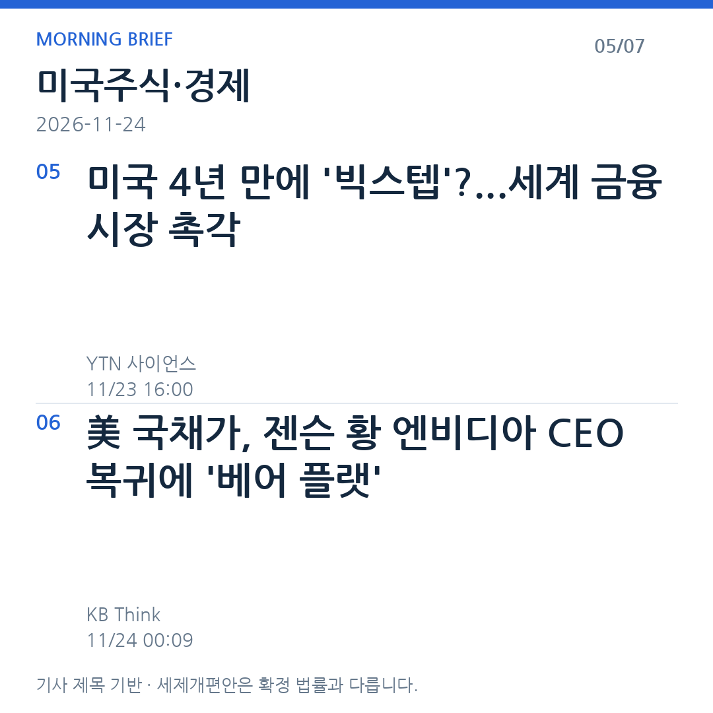
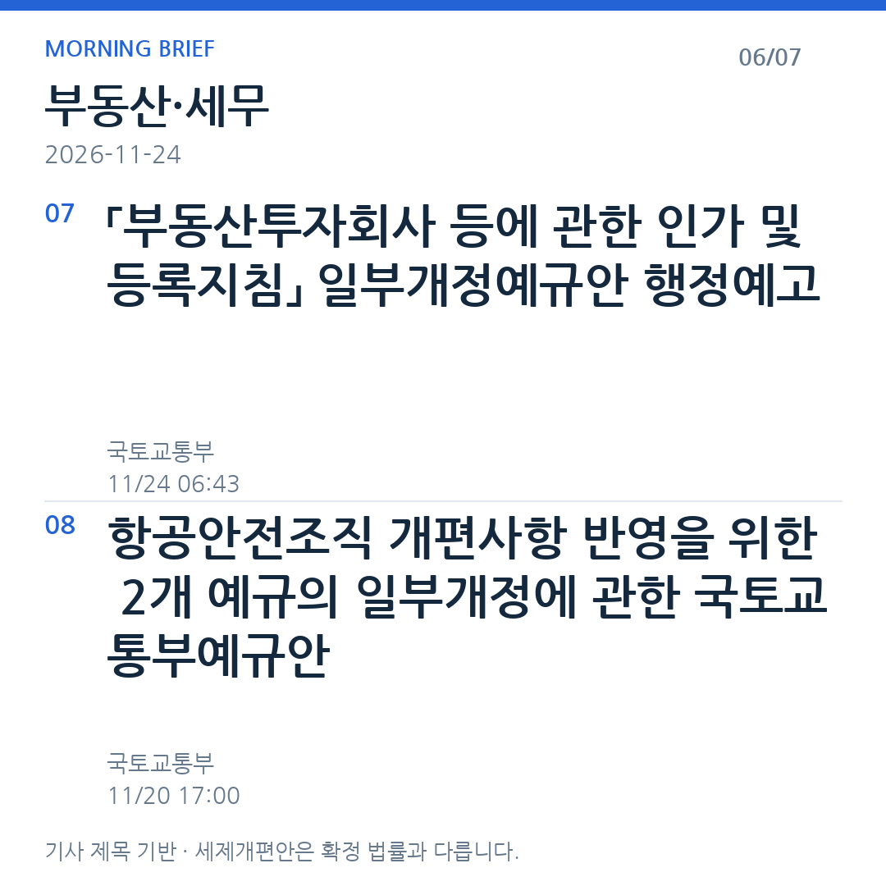
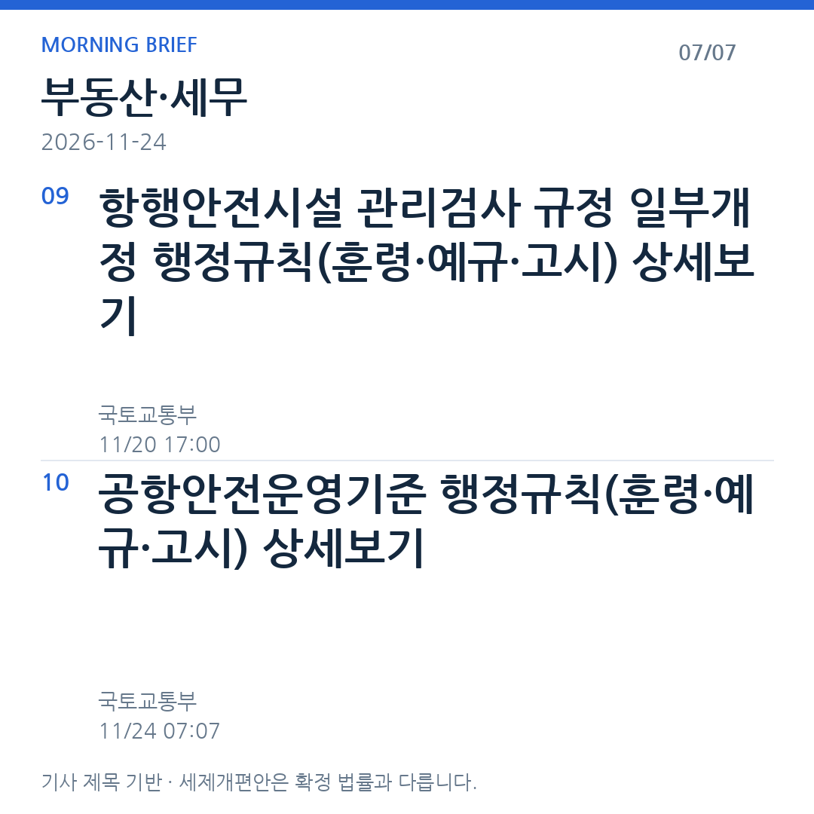

# 2026-11-24 미국주식·세무 브리핑

공개 뉴스 제목 기반입니다. 개별 세무 판단·매매 추천이 아닙니다.

1. [美국채 2년물 금리 4.66%로 상승…뉴욕증시 반등, 12월 인상 확률 98%](https://news.google.com/rss/articles/CBMiZ0FVX3lxTE45VXZKcERwZWZlUGMzOWNOX1NoNnNyYlFjZ0o1MUx3ODdFOUV2VHE2X2RKVXN1VHB4cW1kbGVMWFNib0VpQ3lXcVFyVGVlaFBkb1owWDk5NDlmb29jSmx4WllyUHF3bms?oc=5) — 뉴스1 / 11/24 05:20 KST
2. [S&P500 선물, 젠슨 황 복귀 후 상승세 지속…美 국채금리 혼조](https://news.google.com/rss/articles/CBMickFVX3lxTFBwWnlyMTNKYlBYd3BhQlRCamg0M1BVS1AtZmxhbkxyTUhwQXo2RWZwcGZ2VjRVZUozd0lDS01CZ2pCWVRqOXRUenhLNVBLV2ViYk5BdmRoaXkyTkJjNmRaVWVEeFRvZWxBZHlzQTAzUHZyQQ?oc=5) — KB Think / 11/24 09:41 KST
3. [증시 흔들려도 금리 인상?…'물가잡기'와 '금융안정’ 별도 관리하나 ［심성미의 중앙은행 워치］](https://news.google.com/rss/articles/CBMiWkFVX3lxTE5VcHpqT1J5UkZpLVBkYTN3Y0JOa2RWTXNSWlFqODJrTlJ2NmtaMHhzSHB6VUJhTGpPdUZ1MXhyZWh1akR0Smt0aXAyazVKbEhJMzF0WnkzdFpMUQ?oc=5) — 한국경제 / 11/23 15:21 KST
4. [“설마 4천피 붕괴까지 가겠습니까”…여의도 센터장들이 꼽은 저점은?](https://news.google.com/rss/articles/CBMiUkFVX3lxTFBUcFVYZ1RQd25DWko5UWhEWTFYcEI1bVEyUnlMcVdPUC11cE9JM0ZSSWk5OG5oRXZpYk5DSXI0NklsNFhLWFhvRUpxN29ubldfTVE?oc=5) — 매일경제 마켓 / 11/23 18:56 KST
5. [미국 4년 만에 '빅스텝'?...세계 금융시장 촉각](https://news.google.com/rss/articles/CBMijAFBVV95cUxOT1k0dG9IdElYc18yZjdLR2dob0RreTF3R2dFQzItcFVXcVY3V0t5ekdqWWF4M0xLbmFadXZfZ2VmeGQ3T0xoNVV5TzZQcXVfbHpGNjlHX1E3NmhfTlhPV3RmX18tYjY3MC11ek1MTzVieU5OUHJJTWdyM3VDdXpRZUpjOUJzQThfN28wUA?oc=5) — YTN 사이언스 / 11/23 16:00 KST
6. [美 국채가, 젠슨 황 엔비디아 CEO 복귀에 '베어 플랫'](https://news.google.com/rss/articles/CBMickFVX3lxTFBXYnpjRFNKYnFOclBfOThUc1JPdDZkeWwwelQ2dFh4N0t1c0ZrRlRVaEVkVEpXX0JTUjFvMkRsWVN4VWJlTDBxYXo4WlBGODJHY3hjSXFNeTFWaHRYcWZyamtsNHhpYlNtbVpVX1BUbDZrQQ?oc=5) — KB Think / 11/24 00:09 KST
7. [「부동산투자회사 등에 관한 인가 및 등록지침」 일부개정예규안 행정예고](https://news.google.com/rss/articles/CBMiZkFVX3lxTE8zS2ExSjFnRWtTUU9KUzdZTUpYSEVnNTl0clBEdDQ4cFRMUzJTV1hfTmtURnd4amFmU05xTkJtZG03MXNMdlZVZU1PNlRRVERwSnU5VFVnTlhjeThnNWdQaW5kbmNfdw?oc=5) — 국토교통부 / 11/24 06:43 KST
8. [항공안전조직 개편사항 반영을 위한 2개 예규의 일부개정에 관한 국토교통부예규안](https://news.google.com/rss/articles/CBMi6wJBVV95cUxOWDZwcHZzSWhXbTY4NkRRYlhfLUFjZm1JYXZRYTRrMW9QTVloNXAxbEVJUUhNdXdiS3lCbi1UMEt1OWNUbFhkRlREVG9tMExfampack40SjZ5SzJFVVZtUW5salFSUk1QeHJBVFRGdnJDQVJ5c0lWVnBDUmZKTmQyWmxNMlIyVVRzSUFndmpJeGt0SG9XZWFYNVBuUlR0STd4NXVSV0xFZU44Tmt3ZUdQdWhnV284MmhDWkFpT09xWHFJTlFKTHRNdmVPbUxFX0NiWVc4aWFva0RNNVNOSVB6a0N6Umloc2tKOUVqQmh5QW5wNkplZTZvcFFuTi1KWWFyS3ludGxOcVh6ZkdJS0VpS09Oc2RxWW9kT0ZoYlkzaEpEWXJoM3U1S0RFcDhNQVoxOEZiNk12TlhQRkdJUFV1ZXByRl9sdjIyeUFLWVYzd1JSNG5SSFdocUloMGs3cWh2QnBPRTlGMDNrTkk?oc=5) — 국토교통부 / 11/20 17:00 KST
9. [항행안전시설 관리검사 규정 일부개정 행정규칙(훈령·예규·고시) 상세보기](https://news.google.com/rss/articles/CBMi6wJBVV95cUxQVFhjZHFBSW56S2pvdzlzNldvZ01RWnZfOVhJN0ZrLXNGMTN5UkNEWlZ6TjA0S0d3cnBUdUdJaFhmRDE3OGtOUWpwOWtHZXl6YWQ4WHNpVU81ckI5TVRDR21VanNFQkJFZ01ydDJmNjVTYW1PZmo0SjNrNlZuZVVUZ3RmTTNxTmYyWHhJek81M202R25IX1lFN0ZWbTBFWXA0c3VUYk1YRnRQWjZoWmRpR25BTkZJaWRzZkhON3daMFJ3RVpHVTlUa21DbEFqQVNRMVpfVl95NHlNSUk5Mll0dmoyNlJ6RFQyX1FkU3dZRWszZHVPTEctbDRGbE5lUmFrOTZiQmVlX3RMNXhKQ0NHb2luNnNoQncyMzdYZ1pWYkhmalFLOVRtVERoaWp6OWxMb1RDNjltSS1hblNqaG5TejR0Tlp0cFFKTUtMSzBnUHktZE1MS3NFS2c3dWR6cDdSY1NjMExBX2FQUFE?oc=5) — 국토교통부 / 11/20 17:00 KST
10. [공항안전운영기준 행정규칙(훈령·예규·고시) 상세보기](https://news.google.com/rss/articles/CBMi6wJBVV95cUxPSXRTZ1VSMjJDVUxRVGVnN3d3Qk40Z1ZSQXF6cVNHTGt2NGV1NGtRZi1kek5NTjZBdHNMQWctcWNDWDg5MXNudTdVT3ZscDBsVkd1akZWd19mQ0JDMlZVTjJULTBwa2JVeUZxci1JRW05cVhCODBEekdPMENkcnZxVjUtVEVhMEhnSVp5Z0R0ZmdqT3BFSmoyOGxqMlp6cS1SNmZ2N0RXemFCT0NVU0lvdGpLZVVqX19QZEJyRjhabERTRVV1Y2JpMVNzRl82cUJPR3NrZnJsd29OZndJaUZXcEJQX2hKa1dsX2VLcVp0Y3pTSUpqTjU2QzVWMmhlYmdYRWVqaS1MNzVmMjdpMlBMNXVBS3FhQXhPSGg0MC1wX003cld1ZVRxSlByUS1sbHg0dUhmS0VTU1VSVlF2am5FcUtJMnctN0xfNjV5SVRiUDI2cnlHSzZNaE9FWFdxWndxMHMtWUhJbUlGbUk?oc=5) — 국토교통부 / 11/24 07:07 KST

## 시장 데이터

- [S&P 500](https://finance.yahoo.com/quote/%5EGSPC): 7,237.17 pt, +4.73% / 11/24 06:42 KST / Yahoo Finance 공개 차트 API (지연 가능)
- [나스닥100](https://finance.yahoo.com/quote/%5ENDX): 26,746.10 pt, +6.86% / 11/24 07:15 KST / Yahoo Finance 공개 차트 API (지연 가능)
- [원/달러](https://finance.yahoo.com/quote/KRW%3DX): 1,344.78 원, +0.03% / 11/24 09:51 KST / Yahoo Finance 공개 차트 API (지연 가능)
- [미국 10년 금리](https://finance.yahoo.com/quote/%5ETNX): 4.92 %, +0.60bp / 11/24 04:59 KST / Yahoo Finance 공개 차트 API (지연 가능)
- [VIX](https://finance.yahoo.com/quote/%5EVIX): 26.62 pt, -25.83% / 11/24 06:15 KST / Yahoo Finance 공개 차트 API (지연 가능)
- [금 선물](https://finance.yahoo.com/quote/GC%3DF): 3,653.50 USD/oz, +3.93% / 11/24 09:41 KST / Yahoo Finance 공개 차트 API (지연 가능)
