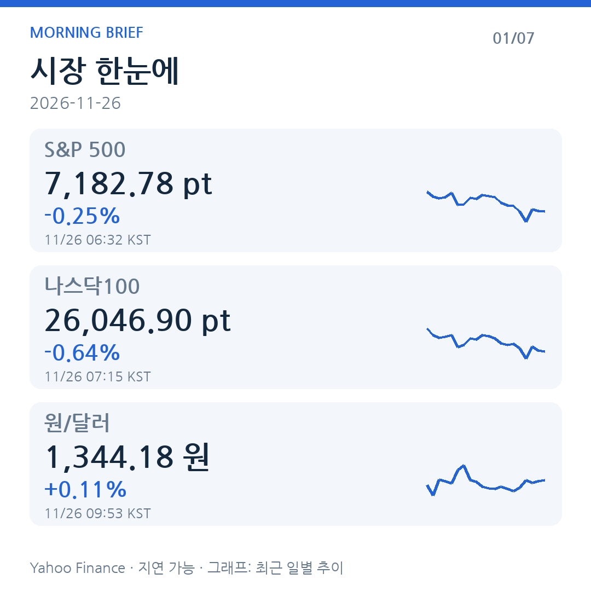
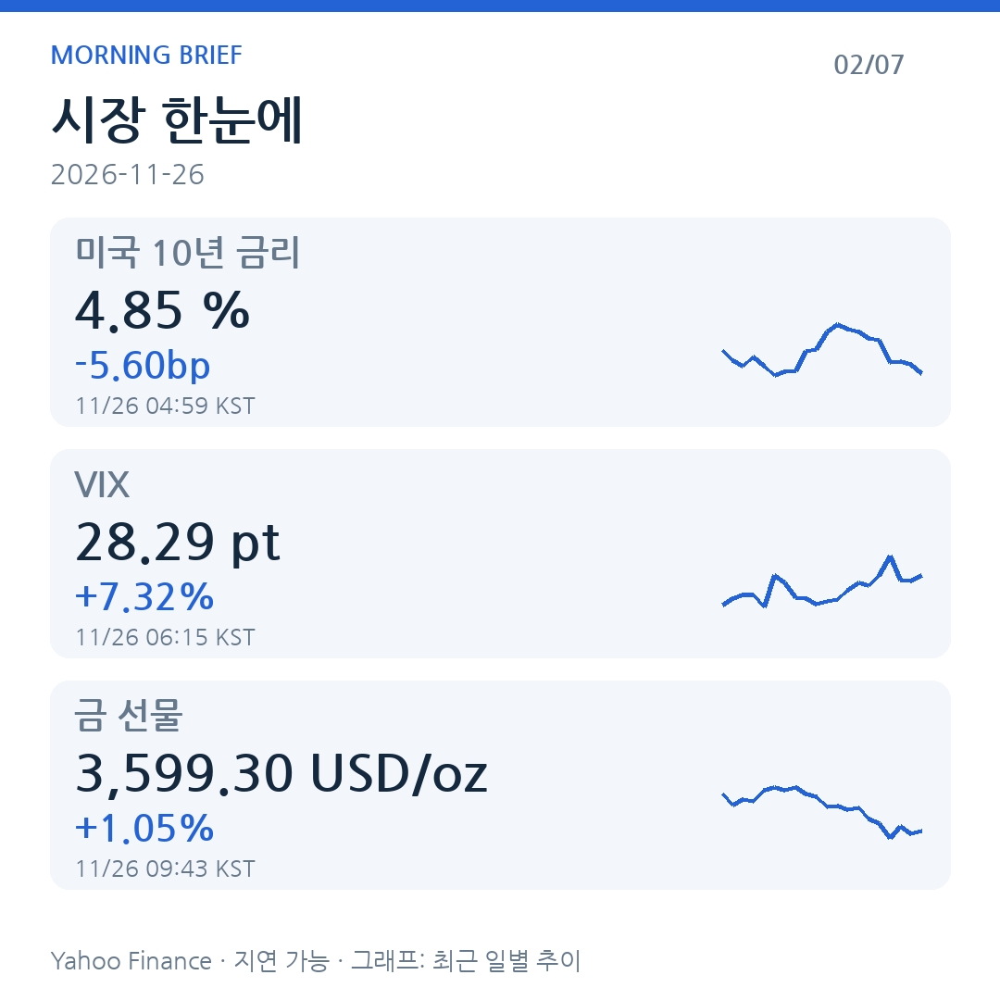
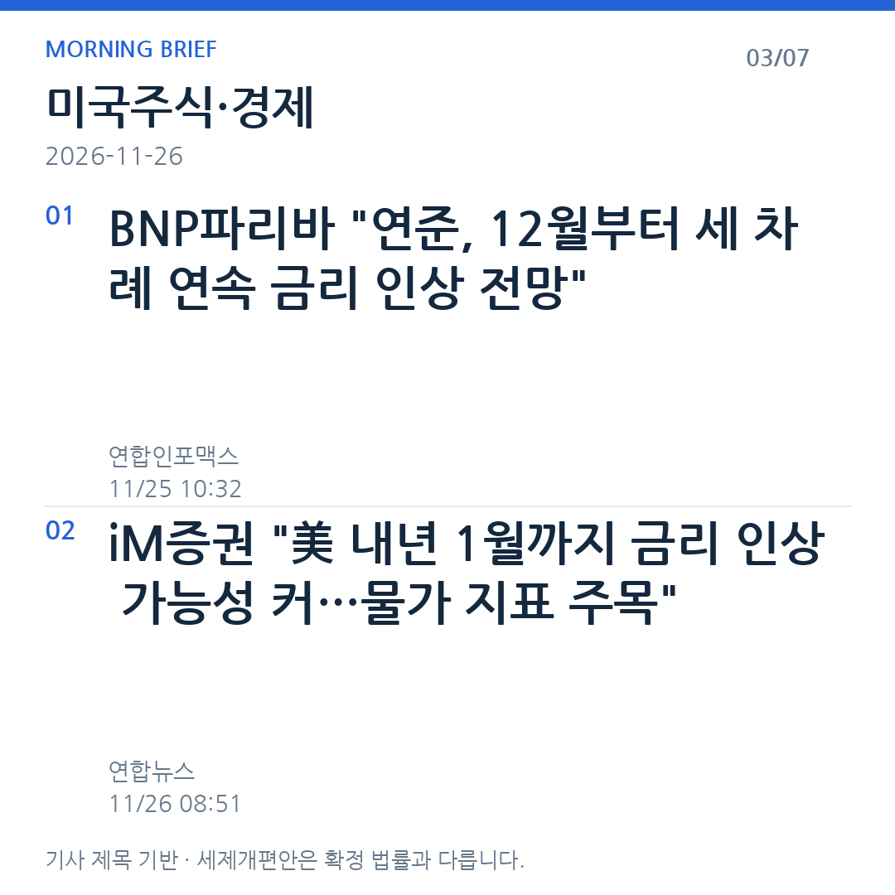
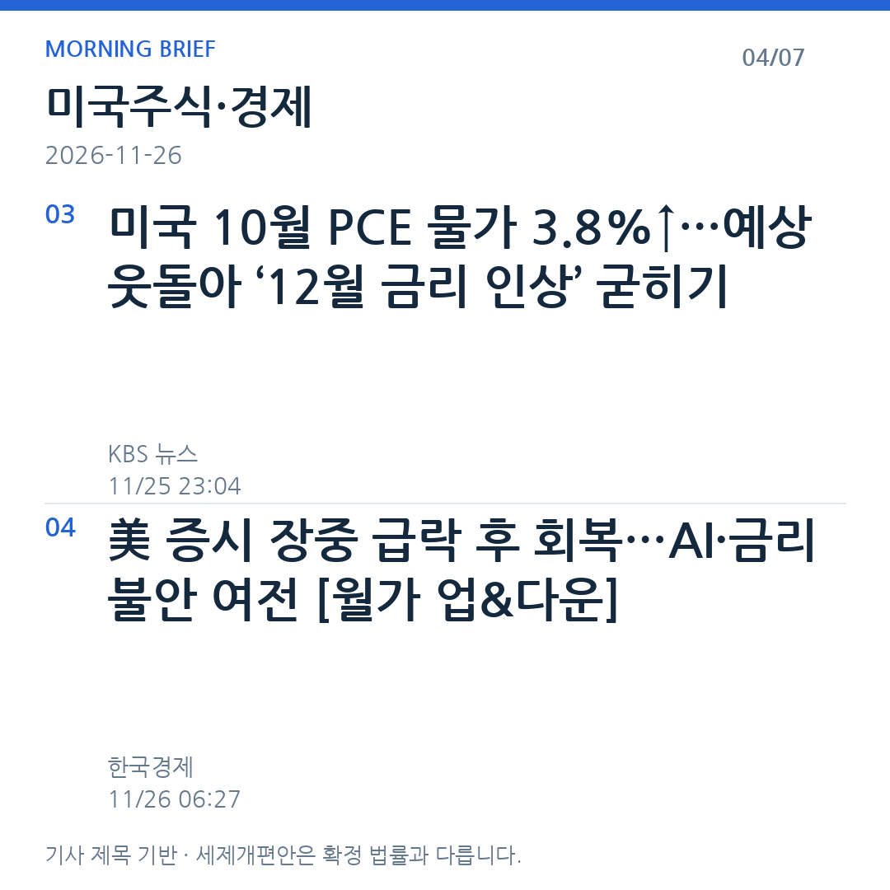
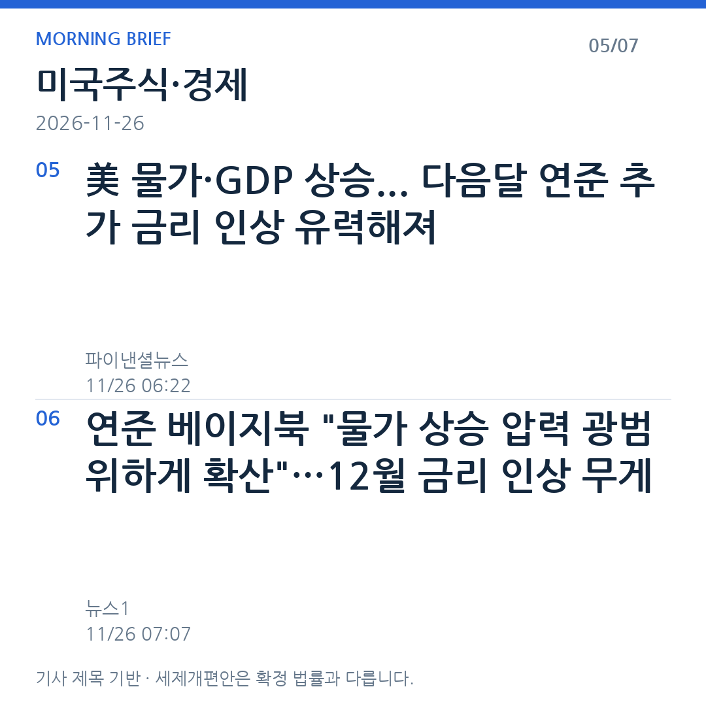
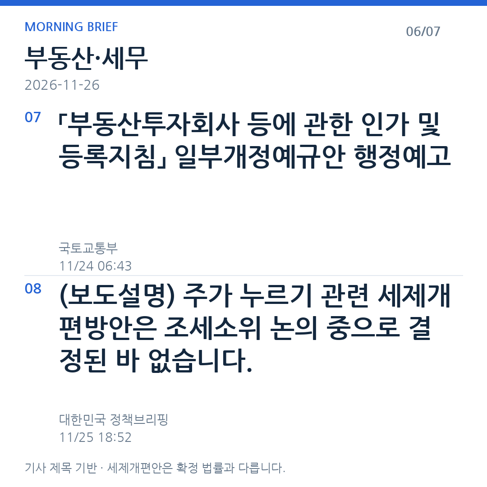
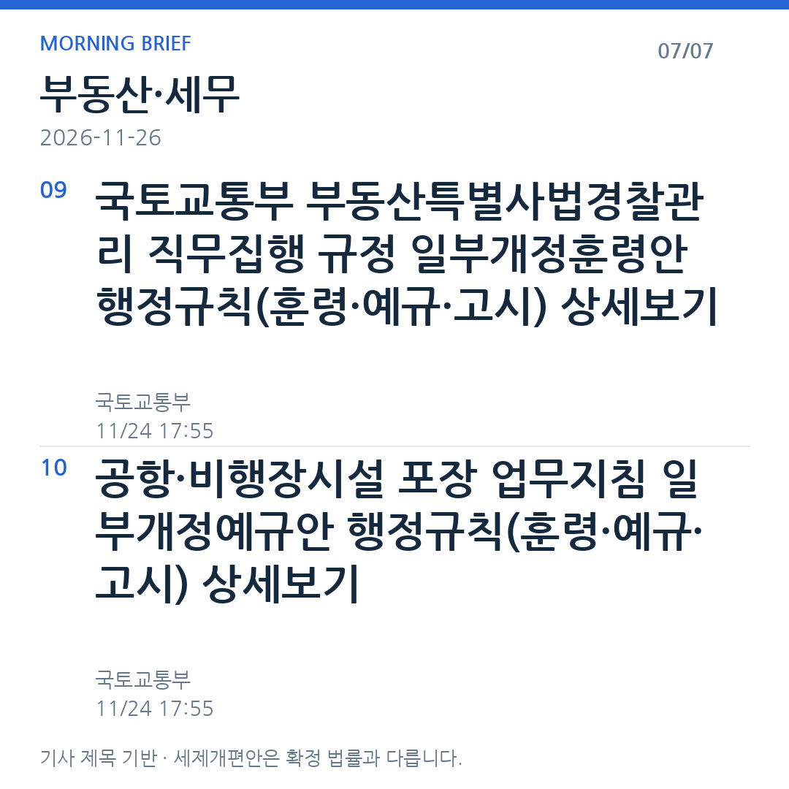

# 2026-11-26 미국주식·세무 브리핑

공개 뉴스 제목 기반입니다. 개별 세무 판단·매매 추천이 아닙니다.

1. [BNP파리바 "연준, 12월부터 세 차례 연속 금리 인상 전망"](https://news.google.com/rss/articles/CBMicEFVX3lxTE84a3JlM2NXd2ludmg5dmlNYWJ5cnA2V2ZwTWE3QzNKakp4NTR3QnZRUXR1Wjg3SHVnVkxjdHlrOGptcVVzMUM5MUdaT1gzclFUM211U2dfX0hVRWV1S2RyVlZ1ZFR0dFFIQTNYdTA5Rl8?oc=5) — 연합인포맥스 / 11/25 10:32 KST
2. [iM증권 "美 내년 1월까지 금리 인상 가능성 커…물가 지표 주목"](https://news.google.com/rss/articles/CBMiW0FVX3lxTE94cU5LdTJ2M0Q2bVUtc0lybjFiVmJ0bWlYYkNwbUFOVVBWTWUyMXhiRU1STHhFRFBpcjVxSF85Tm0welU3Z3Z0aW5uWWNKbDJPVlN0aWg3WjJpS1nSAWBBVV95cUxPNDhOZ29XdnhhdkNOc0F0Z0hUb2xDbGNTTEdKclcyLXB1azB4RzFGLWg0bzhnMFhiOFBnUjFWUlFyQUp4Rkk4djhjLThwMzlIeEJ0Q3M1eXdqUHkwSjZCQnQ?oc=5) — 연합뉴스 / 11/26 08:51 KST
3. [미국 10월 PCE 물가 3.8%↑…예상 웃돌아 ‘12월 금리 인상’ 굳히기](https://news.google.com/rss/articles/CBMiW0FVX3lxTE5ZNkY0bGhkeW55NnpmRHFLUk5MOU5uckNLcnVHQ2xhSzlLTmREbDI0WGN4MVlZZEJMZ29tRTFhWm0wdWxkeWdrSDBRZElSVWpWRDFUazhfa205ZUk?oc=5) — KBS 뉴스 / 11/25 23:04 KST
4. [美 증시 장중 급락 후 회복…AI·금리 불안 여전 ［월가 업&다운］](https://news.google.com/rss/articles/CBMiWkFVX3lxTE9XX2hIa1BaeTFNZFFvMGFCb0I3cnpIYUdQMXFmRUIyaTI5aU9yYjVHSm9jYklXX1B1LWhWRkdRbGhPM0NsREVSb3J6N0dObUFvdlVBV0lRM0RGQQ?oc=5) — 한국경제 / 11/26 06:27 KST
5. [美 물가·GDP 상승... 다음달 연준 추가 금리 인상 유력해져](https://news.google.com/rss/articles/CBMiWkFVX3lxTE5GZ0ZmV0FPRXRILWZlM2xUR25EWkxJd29fTGtzX19QSkZ4SEp5ZGpSM21JZC16OHJoTy1ncnFFNzM2UllTaWFKTWoxWGVUSk53a2NsM2FxLWlYdw?oc=5) — 파이낸셜뉴스 / 11/26 06:22 KST
6. [연준 베이지북 "물가 상승 압력 광범위하게 확산"…12월 금리 인상 무게](https://news.google.com/rss/articles/CBMiWEFVX3lxTE8ydS14NHliemt5aFRNdk5GLVlPYXpGaF9iLUx6OGg3cFNOZTc5QUd3Nzd5U1BBdVJGVVFmTW91V3BCU2N2aFNPNDhINXY2U1EyVWlHMXlHYzI?oc=5) — 뉴스1 / 11/26 07:07 KST
7. [「부동산투자회사 등에 관한 인가 및 등록지침」 일부개정예규안 행정예고](https://news.google.com/rss/articles/CBMiZkFVX3lxTE8zS2ExSjFnRWtTUU9KUzdZTUpYSEVnNTl0clBEdDQ4cFRMUzJTV1hfTmtURnd4amFmU05xTkJtZG03MXNMdlZVZU1PNlRRVERwSnU5VFVnTlhjeThnNWdQaW5kbmNfdw?oc=5) — 국토교통부 / 11/24 06:43 KST
8. [(보도설명) 주가 누르기 관련 세제개편방안은 조세소위 논의 중으로 결정된 바 없습니다.](https://news.google.com/rss/articles/CBMijAFBVV95cUxPcWdabFJvckNGZGVsM3RUb0xrdmhqd1hpRjQ2aHA5MTRGNFRZUDFMam1wSks4LWE1bGZmY1ZONTB4Nkc0SGd6Z3Bvb3NyQThlMWdpNEhvSXpDUlhlUHZ6RTUwN1Y3eHJrVFBiZHRnb2o5eHVDU2k3VHBFMXhwTkxEZVYyLUszYzdkX1JTTQ?oc=5) — 대한민국 정책브리핑 / 11/25 18:52 KST
9. [국토교통부 부동산특별사법경찰관리 직무집행 규정 일부개정훈령안 행정규칙(훈령·예규·고시) 상세보기](https://news.google.com/rss/articles/CBMiZ0FVX3lxTE1Saml6TC1nQW1qTFZUbUNxTkFhc2FLMW9BNmF4cHA0TVdUQTI3cGZwTVp1ZTVraGJCX3pDZmstMmJ0QXRCQXJUWElYTmVYbFgwXzhTeDlyN0tyRDF3TDVSaENwTXd4OFU?oc=5) — 국토교통부 / 11/24 17:55 KST
10. [공항·비행장시설 포장 업무지침 일부개정예규안 행정규칙(훈령·예규·고시) 상세보기](https://news.google.com/rss/articles/CBMiZ0FVX3lxTE5iak16Z0FWa2dFVGh5OS1fMy1hT2NrNHl6S0hKeHVDWXM4NTBUYzVXYWRjVk10RFp0MG5LY0hVdlNlYkpmNHpBMVNGc3NZM2EyeDFiRWI1OUVaYWlaVldBMUo5VmtUd0k?oc=5) — 국토교통부 / 11/24 17:55 KST

## 시장 데이터

- [S&P 500](https://finance.yahoo.com/quote/%5EGSPC): 7,182.78 pt, -0.25% / 11/26 06:32 KST / Yahoo Finance 공개 차트 API (지연 가능)
- [나스닥100](https://finance.yahoo.com/quote/%5ENDX): 26,046.90 pt, -0.64% / 11/26 07:15 KST / Yahoo Finance 공개 차트 API (지연 가능)
- [원/달러](https://finance.yahoo.com/quote/KRW%3DX): 1,344.18 원, +0.11% / 11/26 09:53 KST / Yahoo Finance 공개 차트 API (지연 가능)
- [미국 10년 금리](https://finance.yahoo.com/quote/%5ETNX): 4.85 %, -5.60bp / 11/26 04:59 KST / Yahoo Finance 공개 차트 API (지연 가능)
- [VIX](https://finance.yahoo.com/quote/%5EVIX): 28.29 pt, +7.32% / 11/26 06:15 KST / Yahoo Finance 공개 차트 API (지연 가능)
- [금 선물](https://finance.yahoo.com/quote/GC%3DF): 3,599.30 USD/oz, +1.05% / 11/26 09:43 KST / Yahoo Finance 공개 차트 API (지연 가능)
