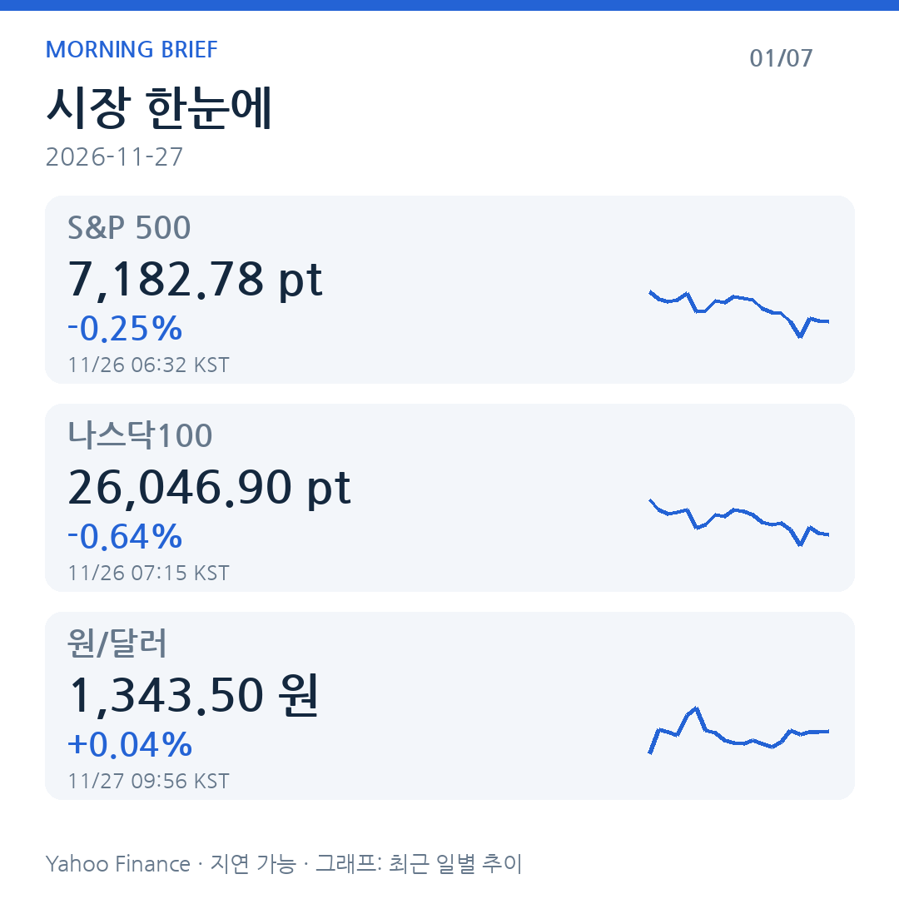
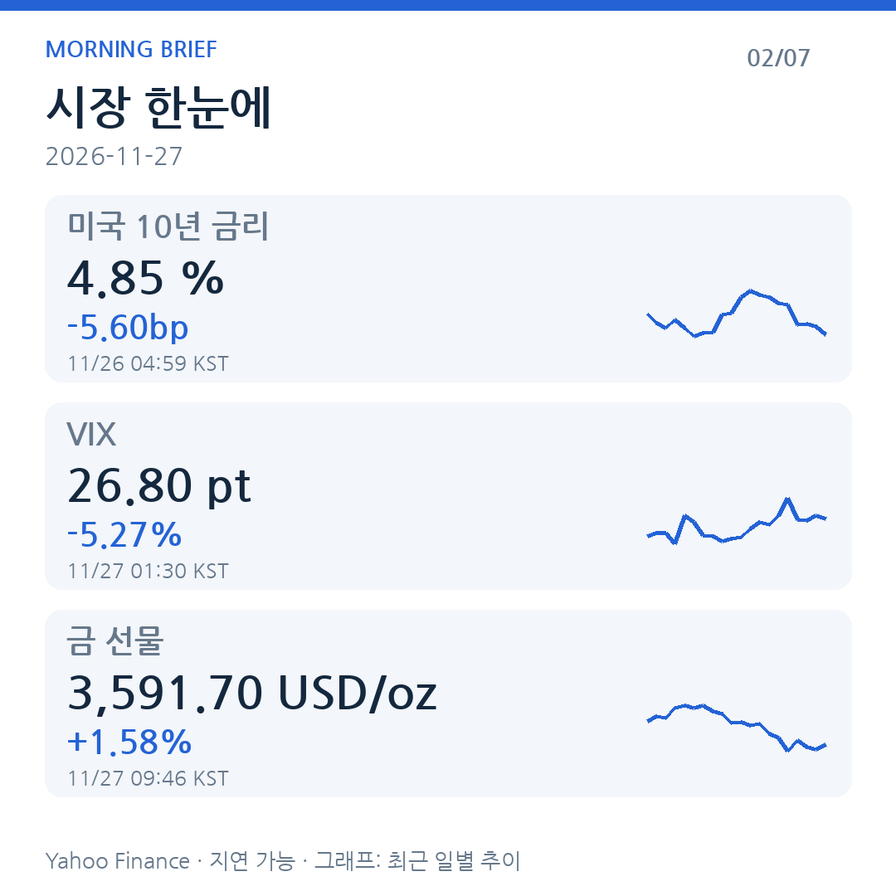
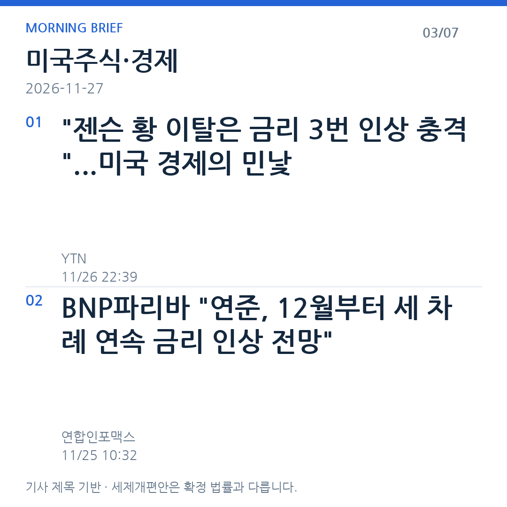
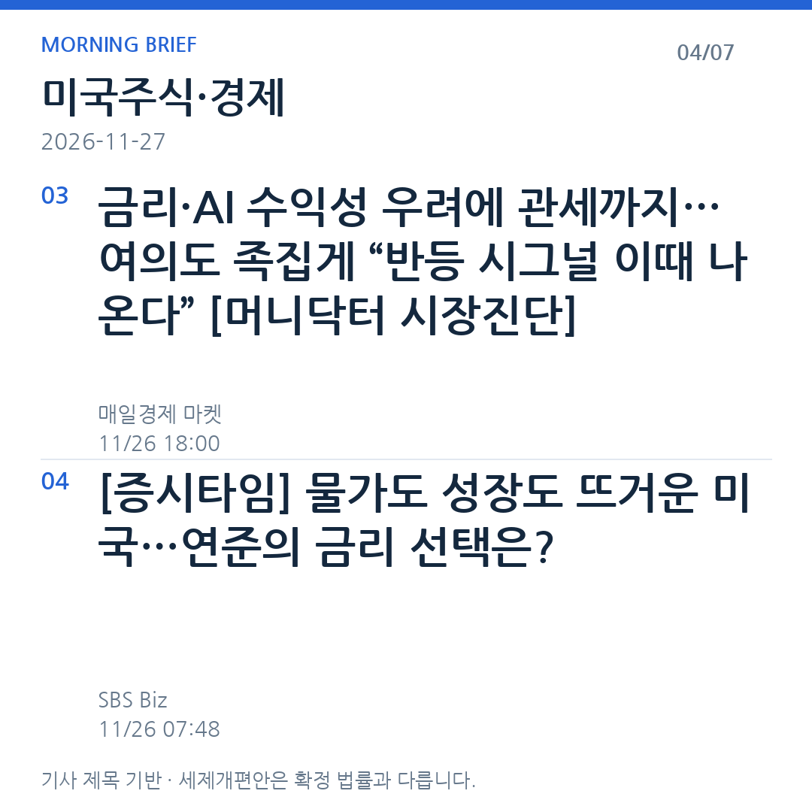
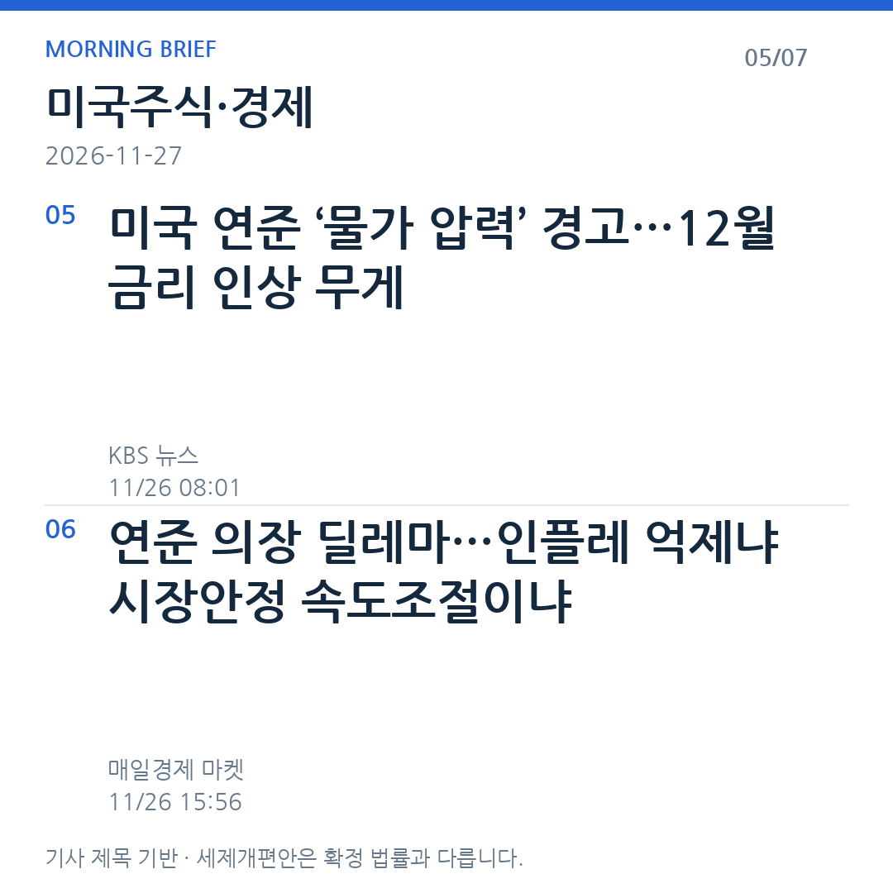
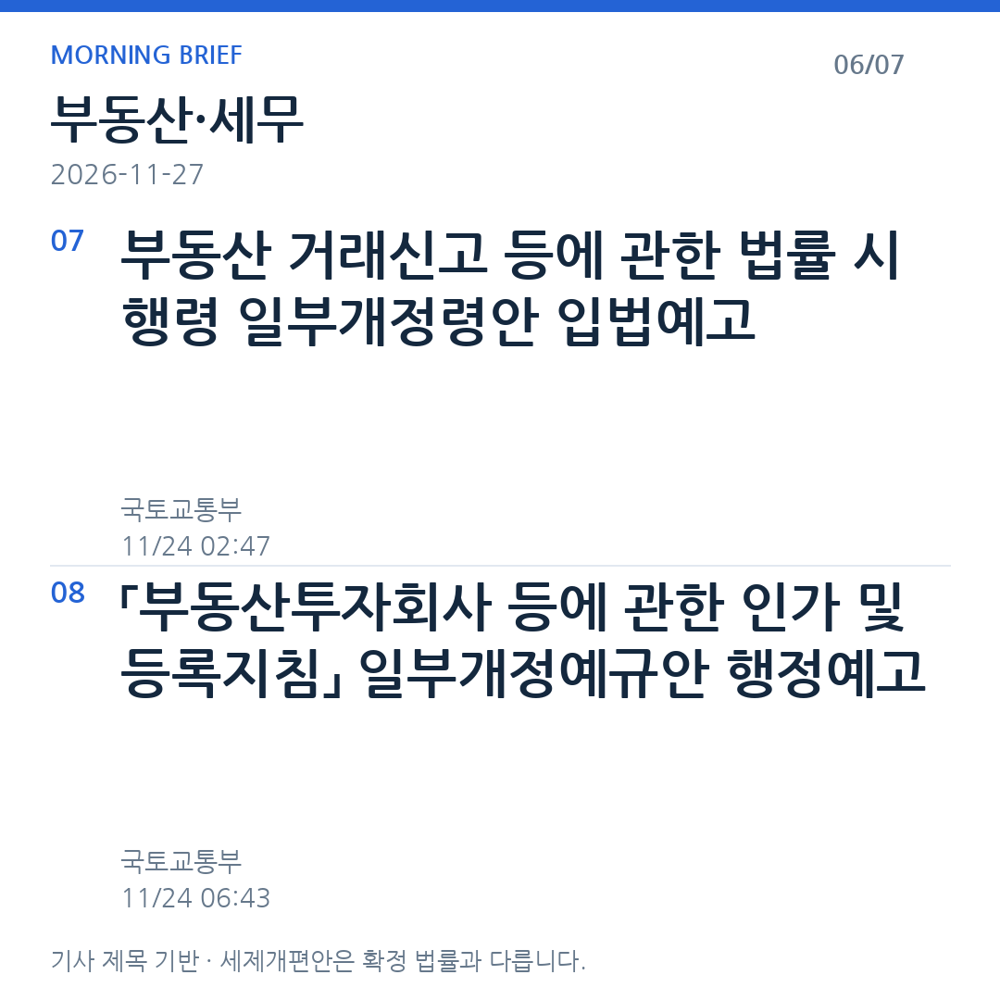
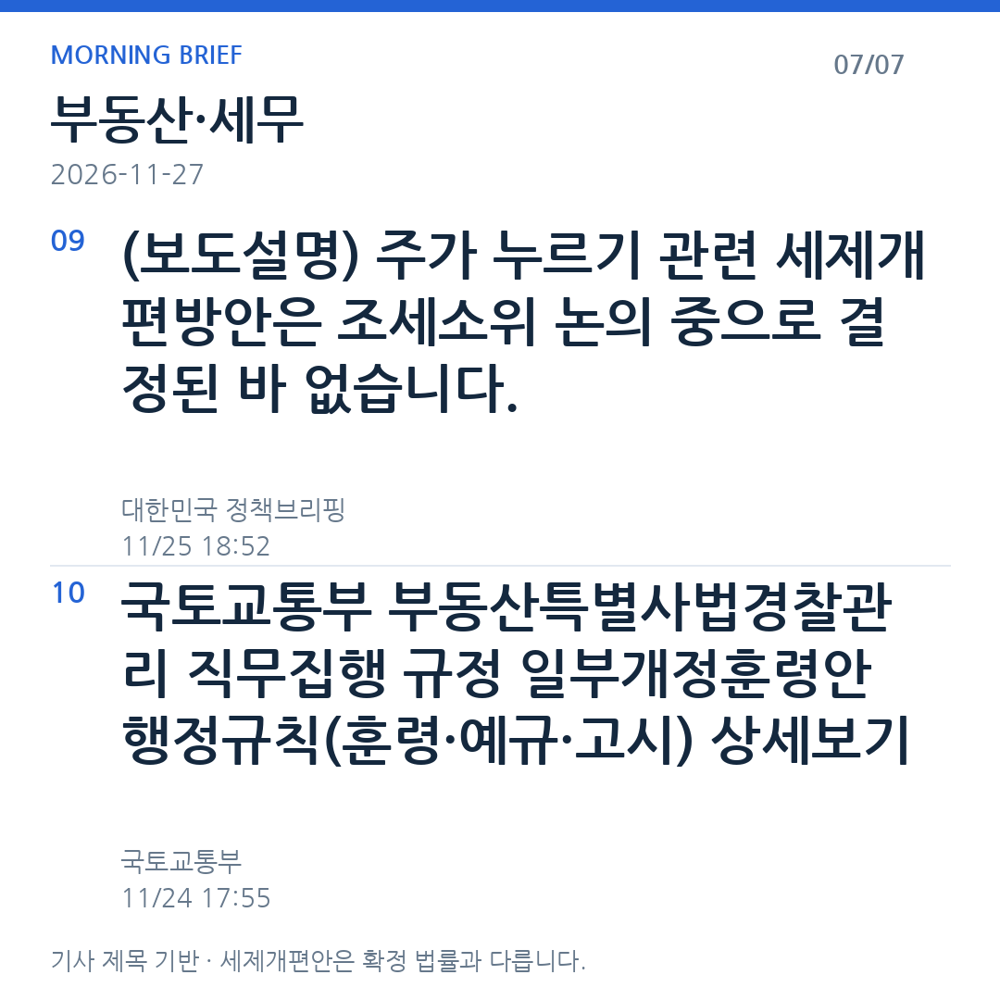

# 2026-11-27 미국주식·세무 브리핑

공개 뉴스 제목 기반입니다. 개별 세무 판단·매매 추천이 아닙니다.

1. ["젠슨 황 이탈은 금리 3번 인상 충격"...미국 경제의 민낯](https://news.google.com/rss/articles/CBMiXkFVX3lxTE8yNFhqVWNRSXdzRG1RblFfenBRT1NWYnBHZ2k3ZmVCRU03bkdsa1lCNU9zVzgtRUw2YkQ1ZzNoWnlFSHhkekM5WlNhSlhmeUFia3VhQk1PNHZ5ZGhKVnc?oc=5) — YTN / 11/26 22:39 KST
2. [BNP파리바 "연준, 12월부터 세 차례 연속 금리 인상 전망"](https://news.google.com/rss/articles/CBMicEFVX3lxTE84a3JlM2NXd2ludmg5dmlNYWJ5cnA2V2ZwTWE3QzNKakp4NTR3QnZRUXR1Wjg3SHVnVkxjdHlrOGptcVVzMUM5MUdaT1gzclFUM211U2dfX0hVRWV1S2RyVlZ1ZFR0dFFIQTNYdTA5Rl8?oc=5) — 연합인포맥스 / 11/25 10:32 KST
3. [금리·AI 수익성 우려에 관세까지…여의도 족집게 “반등 시그널 이때 나온다” ［머니닥터 시장진단］](https://news.google.com/rss/articles/CBMiUkFVX3lxTFAwVVFnSEZVYlNhUE5Jb0tBckZrT1RJRGIzSEx3YnRUWWhodFE1R2dRNjNYUndaMW54Rm1obG1aRWE2Y1pWLU5icERHM2lyYjdmSVE?oc=5) — 매일경제 마켓 / 11/26 18:00 KST
4. [［증시타임］ 물가도 성장도 뜨거운 미국…연준의 금리 선택은?](https://news.google.com/rss/articles/CBMiU0FVX3lxTE54aEdYNDZsU3h2MTJuS3lkYUdtVDV4TnQzSHppOWZ6S3YwYXE4MnRvTEdrOXRTSW1SdUNWUmdaZ2lRaWNjY19YN3hKNUw2X3BVdHZJ0gFYQVVfeXFMUDVaQVIzcE1tb2FwMU5ZTW1YRS0yM2Q1R3gwUFU0YTVqSVhkaUxlXzV2ZHNmcVZOa2kwX3ZCMkdtaGNtdkhreG5tVWo5V0ZnSUlHWVVpZlFlMQ?oc=5) — SBS Biz / 11/26 07:48 KST
5. [미국 연준 ‘물가 압력’ 경고…12월 금리 인상 무게](https://news.google.com/rss/articles/CBMiW0FVX3lxTE1USjhrLUtnOC1Ob2xiY2dGdGd5VlpldGRjTVdzMEdrYlVaSktUVzVNc0hOYnlUcTJ3dWx5M1Vpa0RjX1F1aTFoZFJ2Y1RiSVpCeEtnVkcxcnRHNnc?oc=5) — KBS 뉴스 / 11/26 08:01 KST
6. [연준 의장 딜레마…인플레 억제냐 시장안정 속도조절이냐](https://news.google.com/rss/articles/CBMiUkFVX3lxTFBaM2NaYmwtVjNYX1Zmc04zTlp1NHFEektkelB6UjcwM1JMY0NhdktrSnoxd3NacDVZOEZaek5LMnZxTndyb2VFNzkyUVFYOF8wU2c?oc=5) — 매일경제 마켓 / 11/26 15:56 KST
7. [부동산 거래신고 등에 관한 법률 시행령 일부개정령안 입법예고](https://news.google.com/rss/articles/CBMiZkFVX3lxTFByVEo0NkR6MmNHN3Q3OWdpRVZ4dHZIcVdTTmotV3pUalZDU0xCTjJKZ1lTZzd6X2Vuak13V0hnU0RsTjVpMXMxdEx6c0Z4Wnl3ZVl3VjVENDFFQVhhWmpBYWl6M1NVZw?oc=5) — 국토교통부 / 11/24 02:47 KST
8. [「부동산투자회사 등에 관한 인가 및 등록지침」 일부개정예규안 행정예고](https://news.google.com/rss/articles/CBMiZkFVX3lxTE8zS2ExSjFnRWtTUU9KUzdZTUpYSEVnNTl0clBEdDQ4cFRMUzJTV1hfTmtURnd4amFmU05xTkJtZG03MXNMdlZVZU1PNlRRVERwSnU5VFVnTlhjeThnNWdQaW5kbmNfdw?oc=5) — 국토교통부 / 11/24 06:43 KST
9. [(보도설명) 주가 누르기 관련 세제개편방안은 조세소위 논의 중으로 결정된 바 없습니다.](https://news.google.com/rss/articles/CBMijAFBVV95cUxPcWdabFJvckNGZGVsM3RUb0xrdmhqd1hpRjQ2aHA5MTRGNFRZUDFMam1wSks4LWE1bGZmY1ZONTB4Nkc0SGd6Z3Bvb3NyQThlMWdpNEhvSXpDUlhlUHZ6RTUwN1Y3eHJrVFBiZHRnb2o5eHVDU2k3VHBFMXhwTkxEZVYyLUszYzdkX1JTTQ?oc=5) — 대한민국 정책브리핑 / 11/25 18:52 KST
10. [국토교통부 부동산특별사법경찰관리 직무집행 규정 일부개정훈령안 행정규칙(훈령·예규·고시) 상세보기](https://news.google.com/rss/articles/CBMiZ0FVX3lxTE1Saml6TC1nQW1qTFZUbUNxTkFhc2FLMW9BNmF4cHA0TVdUQTI3cGZwTVp1ZTVraGJCX3pDZmstMmJ0QXRCQXJUWElYTmVYbFgwXzhTeDlyN0tyRDF3TDVSaENwTXd4OFU?oc=5) — 국토교통부 / 11/24 17:55 KST

## 시장 데이터

- [S&P 500](https://finance.yahoo.com/quote/%5EGSPC): 7,182.78 pt, -0.25% / 11/26 06:32 KST / Yahoo Finance 공개 차트 API (지연 가능)
- [나스닥100](https://finance.yahoo.com/quote/%5ENDX): 26,046.90 pt, -0.64% / 11/26 07:15 KST / Yahoo Finance 공개 차트 API (지연 가능)
- [원/달러](https://finance.yahoo.com/quote/KRW%3DX): 1,343.50 원, +0.04% / 11/27 09:56 KST / Yahoo Finance 공개 차트 API (지연 가능)
- [미국 10년 금리](https://finance.yahoo.com/quote/%5ETNX): 4.85 %, -5.60bp / 11/26 04:59 KST / Yahoo Finance 공개 차트 API (지연 가능)
- [VIX](https://finance.yahoo.com/quote/%5EVIX): 26.80 pt, -5.27% / 11/27 01:30 KST / Yahoo Finance 공개 차트 API (지연 가능)
- [금 선물](https://finance.yahoo.com/quote/GC%3DF): 3,591.70 USD/oz, +1.58% / 11/27 09:46 KST / Yahoo Finance 공개 차트 API (지연 가능)
